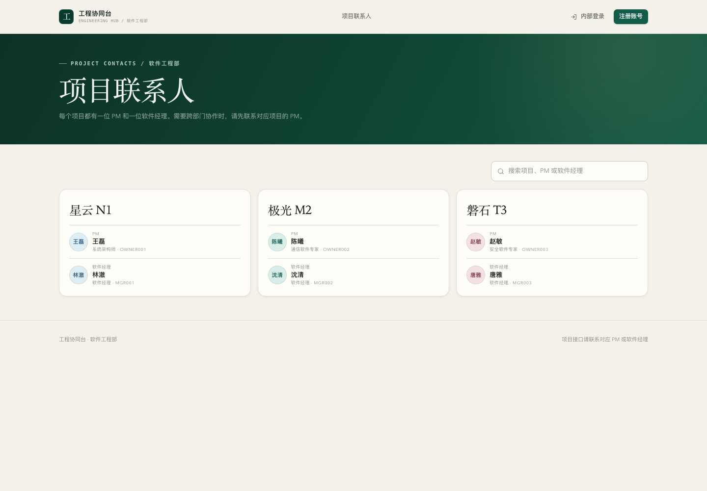
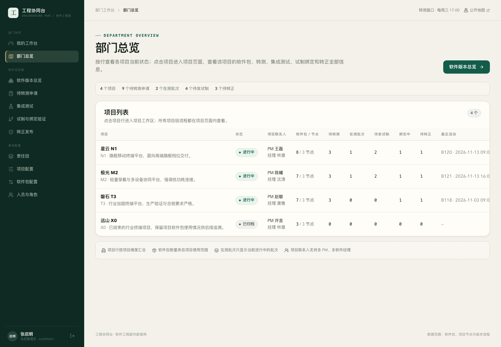
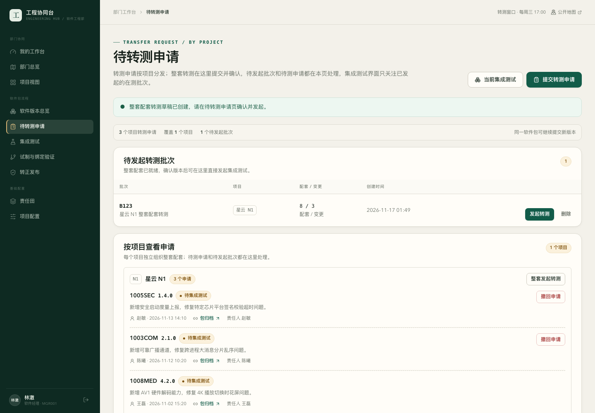
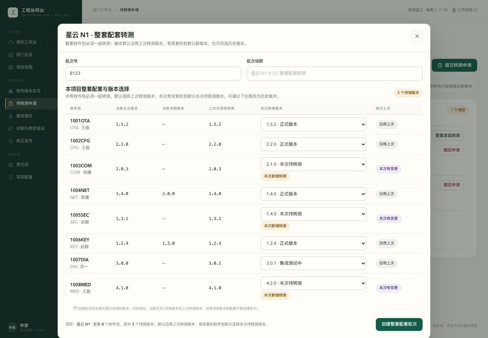
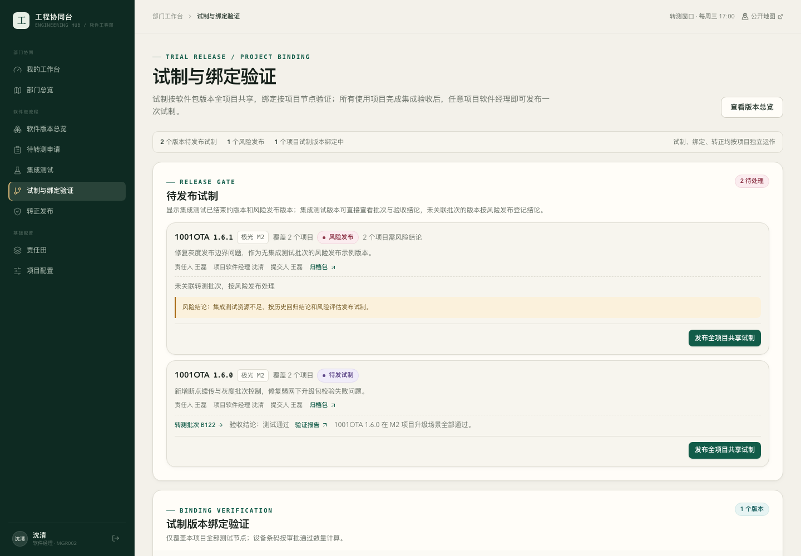
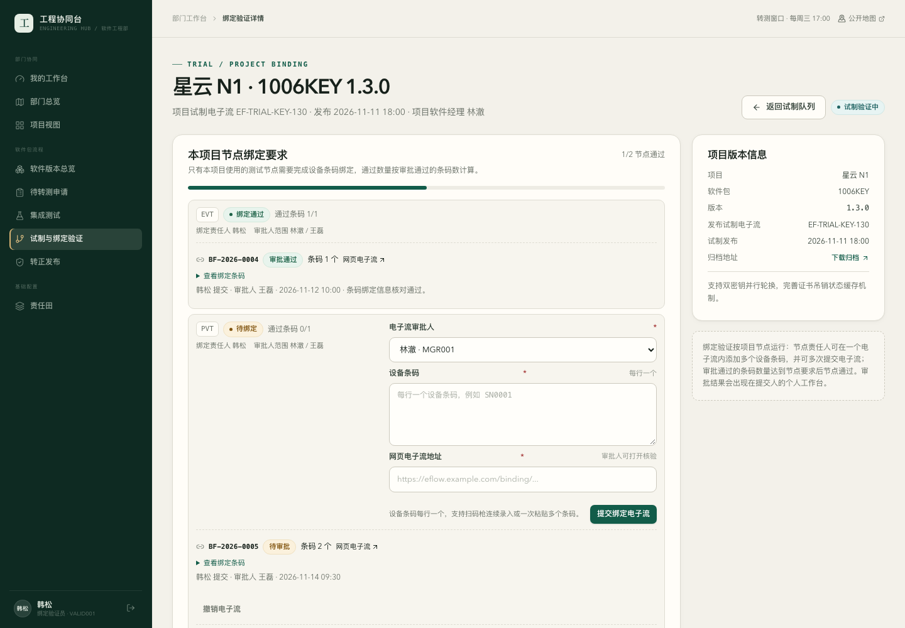
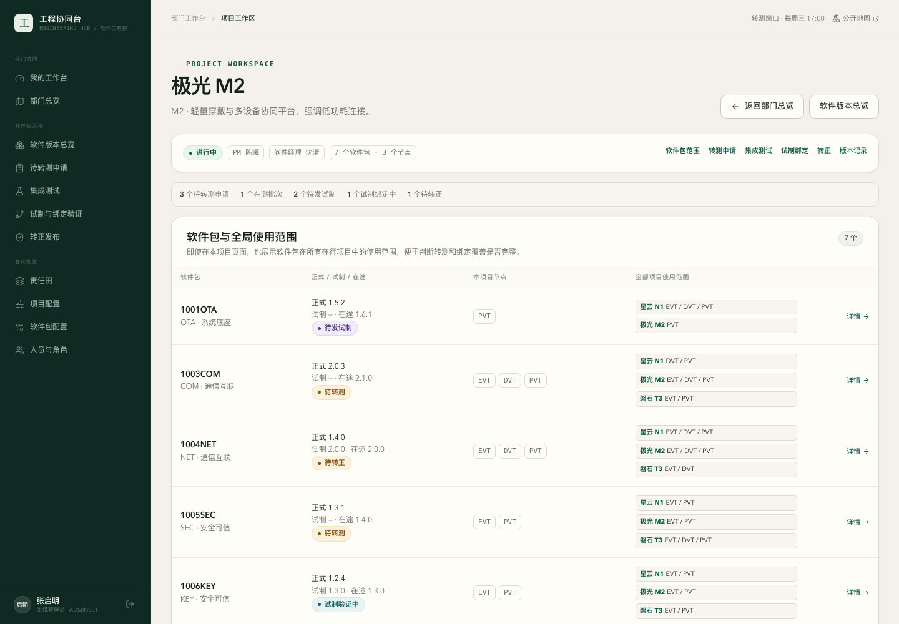
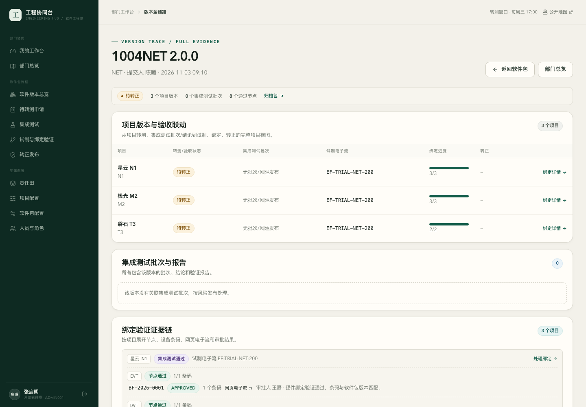
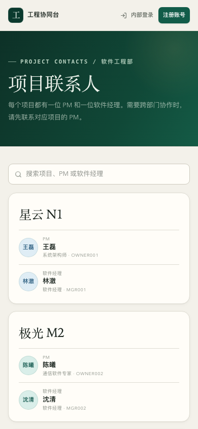

# 工程协同台

软件工程部内部工程工具站点，围绕“公开项目联系人 + 项目维度版本流程 + 集成测试责任田 + 项目节点硬件绑定验证”持续扩展。

> 跨页面业务联动、状态机和场景说明见：[业务逻辑与联动关系](docs/业务逻辑与联动关系.md)。

当前版本按项目组织转测与集成测试，按软件包版本共享试制/转正：部门总览只按行展示项目，项目工作区集中展示全部流程；软件包使用范围始终展示全部在行项目；全部使用项目完成验收后才能发布一次共享试制，全部项目节点绑定通过后一次共享转正；任意版本可进入全链路追溯。

## 界面预览

公开项目联系人首页（无需登录，只展示项目 PM 与软件经理，支持多人）：



个人工作台（登录后首页，只展示自己的待办、异常和通知）：


部门总览（只按行显示可查看项目，点击进入项目工作区）：



责任田配置（所有成员可查看，管理员通过弹窗新建责任田）：


集成测试责任田（项目级测试负责人配置）：


待转测申请（按项目展示待测申请与待发起批次，整套转测在本页完成）：



提交转测申请（软件包支持搜索，四项信息全部填写后才可提交）：


整套配套版本选择（模态弹窗，默认沿用上次转测版本，可下拉改选历史版本）：



集成测试（只保留当前在测批次，历史批次折叠查看）：


项目批次快照与进展说明：


待发布试制（集成测试批次联动、验收结论与风险发布）：



绑定验证（节点按表格行展示，批量条码与网页电子流可展开核验）：



转正发布（填写转正电子流，先核对实际绑定条码和网页电子流）：


项目节点绑定责任配置（主审批人与审批人范围紧凑展示）：


软件包配置（由责任田主管维护）：


软件包总览（按项目筛选列表；使用范围始终展示全部在行项目）：


项目工作区（本项目全部转测、集成测试、试制绑定、待转正信息）：



版本全链路（转测、批次/报告、共享试制、全部项目绑定条码/电子流、转正）：



移动端公开首页：



## 功能概览

### 公开项目联系人

- 只展示在行项目的项目名称、PM 和软件经理。
- 一个项目可以配置多位 PM 和多位软件经理，联系人卡片逐人展示。
- 支持按项目、PM、软件经理姓名或工号搜索。
- 已归档项目不出现在公开首页。
- 不暴露内部版本、测试、绑定或审批数据。

### 个人工作台（登录后首页）

- 登录后进入 `/dashboard`，只展示当前用户需要处理或关注的事项。
- **测试异常**：自己提交的软件包在某个项目集成测试不通过或无法验证时，工作台显示对应项目异常提醒。
- **待我绑定**：试制版本发布后，本项目节点的绑定责任人会看到待提交设备条码的绑定任务。
- **待我审批**：绑定电子流审批人可以看到本项目待审批电子流。
- **项目软件经理待办**：仅显示自己负责项目的待转测申请、进行中批次、待发布试制、待转正事项。
- **集成测试责任田待办**：集成测试责任田的项目负责人会看到本项目待提交测试结论的批次。
- **审批通知**：绑定电子流通过或驳回后，提交人可在“我的绑定电子流”和最新通知中查看结果及审批意见。
- **通知已读**：点击异常提醒或最新通知后会自动标记已读，刷新/返回工作台后该消息消失。
- **待撤销提醒**：试制版本作废后，仍待审批的绑定电子流提交人收到“请撤销电子流”的提醒。

### 责任田主管负责制

- **所有成员都可以查看责任田页面**，包括主管、各项目负责人和项目成员。
- 只有管理员可以新建责任田和指定责任田主管；新建责任田通过页头按钮弹窗完成，不再占用右侧内容区。
- 责任田主管添加或更换各项目负责人。
- 项目负责人再为该项目添加项目成员。
- 责任田卡片完整展示主管、各项目负责人和项目成员。
- 软件包配置由责任田主管维护，软件经理不负责软件包基础配置。
- 集成测试是一个独立责任田，同样配置主管、项目负责人和成员，其项目负责人负责本项目集成测试结论。

### 转测申请与整套批次

- 责任人或软件经理通过“提交转测申请”弹窗提交后，系统为该软件包当前使用的全部在行项目分别生成转测申请。
- 申请页面按项目分组；同一版本会在它使用的多个项目下分别出现。
- 项目软件经理只能看到自己负责项目的待转测申请。
- 同一软件包可以继续提交新版本，上一轮测试未结束不影响提交。
- 转测申请四项必填：软件包、版本号、变更说明、归档链接；软件包支持搜索，未填完四项时提交按钮不可用。
- 整套配套转测直接在待转测申请页的“整套发起转测”弹窗中完成，不再需要单独的“组织转测”页面。
- 创建后的批次先进入“待发起转测批次”，在待转测申请页确认发起；集成测试页不展示待测申请和草稿。
- 每轮转测默认沿用上次本项目转测版本；有新增转测申请的软件包默认新版本，其余包可下拉改选历史版本。
- 如果所选版本在本项目试制阶段已作废，版本选项会标记“本项目已作废”并显示风险提示。

### 项目维度集成测试

- 集成测试页只关注已发起、当前在测的批次；待测申请、版本调整和待发起批次全部在待转测申请页处理。
- 每个批次属于一个项目，包含该项目**全部在用软件包**，不提供配套可选框。
- 每轮转测自动形成整套配套快照：当前正式版本、当前试制版本、上次本项目转测版本、本次转测版本及变化情况。
- 项目批次可由本项目软件经理在待转测申请页发起和终止。
- 集成测试负责人可对批次随时提交进展说明；进展时间线对项目相关成员可见。
- 不同项目、同一项目均可同时存在多个测试批次，适配多台测试设备。
- 测试结论必须由本项目集成测试责任田负责人提交。
- 测试结论提交时必须**上传验证报告**（PDF、图片、Word、Excel、TXT 或 ZIP，≤15MB）。
- 报告通过鉴权文件接口访问，不能绕过系统直接公开下载。
- 已完成/已终止批次收在“历史批次记录”折叠区，主视图一眼只看到当前在测批次。

### 共享试制与项目绑定验证

- 待发布试制按软件包版本聚合；**全部使用项目**都完成集成测试验收（通过或明确风险结论）后，才能发布共享试制。
- 集成测试完成的版本显示各项目关联批次、验收结论、验证报告，可点回批次详情。
- 存在未通过或无批次项目时标记“风险发布”，发布时必须填写全版本风险结论。
- 任意使用项目的软件经理发布一次试制，全部项目版本同步进入 TRIAL；其他项目不再需要发布试制。
- 发布后为全部使用项目的测试节点生成绑定验证任务，按项目节点分别验证。
- 节点绑定要求以表格行展示；设备条码支持批量录入，几十个条码折叠展示。
- 提交绑定电子流必须附带网页电子流地址；提交人可撤销待审批电子流，审批人不能审批自己提交的电子流。
- 只有全部使用项目的全部节点条码数量都达标，所有项目版本才一起进入 PENDING_FORMAL。
- 共享试制作废会同步作废全部项目版本，并提醒全部项目待审批电子流提交人撤销。

### 共享转正发布

- 转正页按软件包版本聚合，一个版本只出现一次，展示全部使用项目。
- 全部项目均为 PENDING_FORMAL 且全部绑定要求 PASSED 后，任意项目软件经理提交一次转正电子流。
- 所有项目版本同步 FORMAL；其他项目不再需要、也不能重复转正。
- 转正前可展开查看每个项目的节点、通过条码、网页电子流和验收/风险结论。
- 可从转正页进入版本全链路，回看完整证据。

### 软件包总览

- 支持按项目筛选软件包列表。
- 筛选项目只限制列表范围，**使用范围列始终展示全部在行项目**，便于判断软件包是否跨项目使用。
- 已归档项目不在使用范围展示；归档记录保留在项目工作区/存档项目。
- 详情抽屉由服务端预加载；版本历史每个版本可进入“版本全链路”。
- 责任田主管、责任田项目负责人、管理员可修改软件包责任信息；软件经理不能修改软件包配置。

### 软件包配置

- 软件包配置由**责任田主管**维护，系统管理员可维护全部责任田。
- 软件经理访问软件包配置会被拒绝，软件包详情抽屉中的责任信息编辑入口也不会显示。
- 责任田主管只能看到并维护自己责任田下的软件包。
- 支持新建软件包、维护名称/编码/责任人/所属责任田/说明，并配置项目测试节点使用范围。

### 项目与节点配置

- **只有管理员可以新增项目**，通过页头“新增项目”按钮弹窗完成；软件经理可以编辑已负责的项目，但看不到新增入口。
- 一个项目可以配置多位 PM 和多位软件经理；每位软件经理都具有该项目的流程权限。
- 每个项目软件经理只能处理自己项目的转测、测试批次、试制、作废与转正。
- 测试节点必须配置绑定验证责任人与主审批人，二者不能是同一人；主审批人自动进入审批人范围，还可增加其他审批人。
- 节点配置表单在展开时全宽显示，不再出现排版错位。
- 节点支持修改绑定责任、主审批人、审批人范围和绑定通过数量。
- 审批人范围以紧凑芯片展示，添加/移除操作不会再撑大第二个及后续人员。
- 编辑项目不再显示排序字段，排序由系统保留。
- 项目归档后移入存档项目：保留历史软件包使用与版本情况；不再参与新转测、测试和绑定。

### 部门总览与项目工作区

- **部门总览只按行展示各项目**，不再展示全局待转测/测试列表。
- 只展示当前用户权限范围内的项目行：软件经理只看自己的项目，防止通过总览查看其他项目转测/验证。
- 点击项目进入 `/projects/[id]` 项目工作区。
- 项目工作区聚合：
  - 项目信息、多 PM/多软件经理、节点；
  - 全部软件包及全局项目使用范围；
  - 本项目待转测申请；
  - 集成测试批次和历史；
  - 待发试制、绑定中版本；
  - 待转正版本；
  - 项目全部版本流程记录，可进入版本全链路。
- 项目工作区对软件经理做项目访问校验，非本人项目会回到部门总览。
- 旧 `/projects` 入口兼容跳转到部门总览。

### 版本全链路

- `/versions/[id]` 提供任意版本的完整质量回溯。
- 展示全部使用项目的转测/验收状态、集成测试批次结论/报告、试制电子流/风险结论、绑定节点/条码/电子流/审批、转正电子流。
- 可从软件包抽屉版本历史、批次快照、试制详情、转正页进入。

### 稳定性与性能

- 移除了全局布局中每次导航都重复计算全部工作台统计的逻辑，只在实际进入个人工作台时查询数据。
- 关闭侧边导航的自动预取，避免一次导航触发大量并发 RSC 请求造成 CPU 峰值。
- 增加路由级加载骨架和常用查询索引。
- 软件包详情由服务端预加载；部门总览/项目工作区使用服务端路由，降低对客户端水合的依赖。

### 评审中心

本版本仍不包含评审中心。评审专家角色作为预留角色保留。共享试制/转正由使用该软件包的项目软件经理结合全部项目测试结论、风险和绑定结果直接操作；评审场景待需求明确后重新实现。

## 核心流程

```text
责任人提交版本
   ↓
按软件包使用范围生成各项目转测申请
   ↓
各项目软件经理分别组织整套批次、完成集成测试
   ↓
全部使用项目验收完成（通过或明确风险结论）
   ↓
任意项目软件经理发布一次全项目共享试制
   ↓
为全部使用项目的节点生成绑定任务
   ↓
各项目绑定责任人提交条码/网页电子流，各项目审批人审批
   ↓
全部使用项目全部节点绑定通过 → 所有项目版本同步待转正
   ↓
任意项目软件经理填写一次转正电子流 → 全部使用项目同步正式版本

绑定不通过：
任意项目软件经理作废共享试制 → 全部项目版本 VOID，提醒全部待审批电子流提交人撤销

风险发布：
任一使用项目无批次或测试未通过 → 发布共享试制时填写全版本风险结论
后续重新转测 → 队列/详情/版本全链路按最新批次和验收结论联动
```

### 关键规则

- 转测批次默认沿用上次本项目转测版本，有新增转测的包默认新版本，也可在表格下拉框改选历史版本。
- 测试结论、进展说明、验证报告必须由对应项目的集成测试责任田负责人提交；集成测试主管可查看全部项目。
- 通知点击后自动已读并消失。
- 绑定电子流审批人须在节点审批人范围内选择；提交人可撤销自己的待审批电子流。
- 一个项目可配置多位 PM、多位软件经理；软件经理权限按项目成员关系判定。
- 转测申请必须四项信息完整才可提交；软件包选择支持搜索。
- 待发布试制需展示集成批次/验收结论；无批次版本必须登记风险结论。
- 绑定电子流必须附带可访问的网页电子流地址。
- 编辑项目不再需要维护排序；新建项目仅管理员可操作。
- 软件包配置仅责任田主管和系统管理员可操作。
- 待发起批次只在待转测申请页展示；集成测试页只展示在测批次。
- 转测申请、集成测试批次、项目工作区按项目隔离；试制/转正按软件包版本全项目共享。
- 每个测试批次只属于一个项目，且必须覆盖该项目全部在用软件包。
- 同一项目、不同项目均允许并行测试批次；上一轮未结束可提交新版本。
- 测试结论仅回写本项目对应的项目版本记录；所有使用项目的验收都结束后才能发布共享试制。
- 共享试制发布一次，生成全部使用项目的节点绑定要求；节点通过数量按审批通过的设备条码数计算。
- 只有全部使用项目全部节点绑定通过，所有项目才一起进入待转正。
- 共享转正发布一次，全部使用项目同步为正式版本。
- 部门总览只按行展示项目；软件经理不能看到或进入其他项目流程。
- 软件包总览按项目筛选时，使用范围仍展示全部在行项目。
- 版本全链路可回溯转测、验收、试制、绑定条码、电子流和转正。
- 项目软件经理只看到并处理自己项目的待办和操作入口。
- 管理员创建责任田并指定主管；主管维护项目负责人；项目负责人维护项目成员。

## 技术栈

| 技术 | 说明 |
| --- | --- |
| Next.js 16 App Router | 页面渲染、Route Group、Server Actions |
| React 19 + TypeScript | 服务端组件与少量交互客户端组件 |
| SQLite (`node:sqlite`) | 单机持久化，适合 < 1000 人的部门系统 |
| Tailwind CSS 4 + 自定义样式 | 统一视觉与响应式布局 |
| Playwright | 关键业务流程端到端测试 |
| Node.js >= 22.5 | 使用内置 `node:sqlite` |

## 快速开始

```bash
pnpm install
pnpm dev
```

打开 [http://localhost:3000](http://localhost:3000)。首次启动会自动创建数据库并写入演示数据（`data/toolkit.db`）。

### 演示账号

统一密码：`Demo@1234`

| 工号 | 姓名 | 角色 | 适合体验的操作 |
| --- | --- | --- | --- |
| ADMIN001 | 张启明 | 系统管理员 | 新建责任田、指定责任田主管、全部配置 |
| MGR001 | 林澈 | 软件经理 | 星云 N1：在待转测页发起整套配套、发试制/作废、转正 |
| MGR002 | 沈清 | 软件经理 | 极光 M2：只处理 M2 项目流程 |
| MGR003 | 唐雅 | 软件经理 | 磐石 T3：只处理 T3 项目流程 |
| TEST001 | 周宁 | 集成测试 / 集成测试责任田主管 | 星云 N1 集成测试结论和验证报告 |
| TEST002 | 何欣 | 集成测试 / M2 集成测试负责人 | 极光 M2 集成测试结论 |
| TEST003 | 程野 | 集成测试 / T3 集成测试负责人 | 磐石 T3 集成测试结论 |
| OWNER001 | 王磊 | 系统底座责任田主管 / 软件包责任人 / N1 绑定审批人 | 维护系统底座软件包配置，提交 OTA/CFG/MED 转测，审批 N1 绑定电子流 |
| OWNER002 | 陈曦 | 通信互联责任田主管 / 软件包责任人 / M2 绑定审批人 | 维护通信互联软件包配置，提交 COM/NET 转测，审批 M2 绑定电子流 |
| OWNER003 | 赵敏 | 安全可信责任田主管 / 软件包责任人 / T3 绑定审批人 | 维护安全可信软件包配置，提交 SEC/KEY 转测，审批 T3 绑定电子流 |
| OWNER004 | 郑一 | 软件包责任人 | 提交 DIA 转测 |
| VALID001 | 韩松 | 绑定验证员 / 硬件绑定责任人 | 提交设备条码与绑定电子流 |
| MEMBER001 | 许言 | 部门成员 | 只读查看内部工作台 |

> 演示账号只用于本地体验。正式部署前必须清空演示数据并修改所有初始密码。

### 演示数据状态

- 3 个在行项目：星云 N1（林澈）、极光 M2（沈清）、磐石 T3（唐雅）；1 个存档项目：远山 X0。
- 8 个软件包，名称为 4 位数字 + 3 位字母，例如 `1001OTA`。名称格式当前不强制校验。
- 责任田：系统底座、通信互联、安全可信、质量与工具、集成测试。
- B118（磐石 T3）测试不通过；B119/B122 测试通过；B120（N1）、B121（M2）测试中，演示多项目并行。
- 1001OTA 1.6.0 在 N1/M2 均完成集成测试，待发布一次共享试制；待发布卡片展示批次和通过结论。
- 1001OTA 1.6.1 在 N1/M2 为无批次风险发布示例，展示共享试制风险结论。
- 1004NET 2.0.0 在 N1/M2/T3 已全部完成绑定验证，按共享版本进入待转正，转正页按版本聚合展示全部项目条码。
- 1006KEY 1.3.0 在 N1/M2/T3 已按共享版本发布试制；N1 节点 1/2 通过，存在待审批/被驳回电子流，M2/T3 绑定待处理。
- 1003COM、1005SEC 有待安排转测申请；可在待转测申请页发起整套批次。
- B120/B121 已有集成测试进展说明；节点审批人范围包含项目 PM 和项目软件经理。
- B122 等批次记录用于验证历史批次折叠；等待发起的批次在待转测申请页处理。
- 集成测试责任田：主管周宁、程野，项目负责人 N1 周宁、M2 何欣、T3 程野。
- 韩松是全部在行项目节点的绑定责任人；王磊、陈曦、赵敏分别是各项目绑定审批人。

## 权限与角色

### 系统角色

| 角色 | 主要职责 |
| --- | --- |
| 系统管理员 | 创建责任田/项目、指定责任田主管、全部配置和流程管理 |
| 软件经理 | 可被多个项目配置为软件经理；处理被分配项目的转测、测试、试制、作废、转正；不负责软件包配置 |
| 集成测试 | 承担集成测试责任田工作；仅项目负责人/主管可提交结论 |
| 软件包责任人 | 提交本人软件包转测申请；责任田主管可维护本责任田软件包配置 |
| 绑定验证员 | 作为硬件团队绑定责任人提交设备条码和绑定电子流 |
| 部门成员 | 只读查看内部工作台 |
| 评审专家 | 预留角色，当前无流程操作 |

### 项目内责任

- 项目 PM：项目联系人，可多人。
- 项目软件经理：本项目版本流程负责人，可多人；每位都具有本项目流程权限，并只看到本项目待办。
- 集成测试责任田项目负责人：本项目集成测试结论与报告提交人。
- 节点绑定验证责任人：负责本项目节点设备条码电子流提交。
- 节点绑定电子流审批人：负责本项目节点电子流审批。
- 责任田主管：维护本责任田各项目负责人和软件包配置。
- 软件经理：维护本项目版本流程，不配置软件包基础信息。
- 项目负责人：维护本责任田本项目成员，可修改本责任田软件包责任信息。

所有权限不仅在页面隐藏入口，Server Action 也会重新校验登录状态、角色、责任田层级、项目软件经理归属、项目节点归属和电子流关系。

## 常用命令

```bash
pnpm dev              # 开发模式
pnpm build            # 生产构建
pnpm start            # 启动生产服务（需先 build）
pnpm typecheck        # TypeScript 类型检查
pnpm lint             # ESLint
pnpm test:e2e         # 运行 Playwright E2E（使用独立 data/e2e.db）
pnpm test:e2e:full    # 构建后运行 E2E
pnpm db:seed          # 确保数据库表和演示数据存在
pnpm db:reset         # 删除数据库（谨慎！会清空全部数据）
pnpm admin:create -- <姓名> <工号> <密码>  # 创建或提升一个管理员
```

### 环境变量

参见 [`.env.example`](.env.example)。

| 变量 | 默认值 | 说明 |
| --- | --- | --- |
| `NEXT_PUBLIC_DEPARTMENT_NAME` | 软件工程部 | 部门名称展示 |
| `DATABASE_PATH` | `./data/toolkit.db` | SQLite 文件路径 |
| `SESSION_COOKIE_SECURE` | 生产环境 `true` | HTTPS 部署保持 true；本地 HTTP 生产验收设 false |
| `TOOLKIT_SKIP_SEED` | `0` | 设为 `1` 时不写入演示数据 |

## 测试与验证

E2E 使用独立 `data/e2e.db`，启动时清空该文件，不会污染开发/演示数据库。当前覆盖 **19 个端到端场景**：

1. 公开首页只展示项目 PM 和软件经理，支持按经理搜索。
2. 未登录访问内部页面跳转登录，错误密码有提示。
3. 注册、自动登录、角色限制与退出登录。
4. 公开首页到内部工作台。
5. 移动端可见退出登录入口。
6. 责任田主管 → 项目负责人 → 项目成员三级管理权限。
7. 项目节点绑定配置排版、审批人范围与通过数量修改。
8. 软件包配置仅责任田主管可访问，软件经理不能进入或编辑；新建项目仅管理员可操作。
9. 个人工作台只展示本项目软件经理待办、集成测试责任田任务、异常与绑定提醒。
10. 通知点击后标记已读并消失。
11. 待转测申请弹窗提交、按项目分发、申请撤回。
12. 整套配套在待转测申请页创建并确认发起，版本可选择历史版本，集成测试页仅保留在测批次。
13. 集成测试责任田负责人提交进展说明、结论并上传验证报告。
14. 全项目共享试制：N1 完成绑定后仍需等待 M2，全部项目节点通过后一次转正、全部项目同步正式版本；批量条码（含 40 个条码）、审批人范围、网页电子流、绑定验证人撤销电子流。
15. 作废项目试制版本后，绑定责任人收到撤销提醒并撤销电子流；转测版本下拉框标记已作废版本并提示。
16. 软件包按项目筛选时使用范围仍展示全部项目；部门总览只展示本项目经理有权项目；点击进入项目工作区；版本全链路可回溯。
17. 责任田主管通过弹窗新建软件包并进入使用范围配置。
18. 待发布试制展示共享版本的集成批次/验收结论，风险版本可登记全版本风险结论并发布共享试制。
19. 项目配置多位 PM/软件经理后，新增软件经理获得该项目流程权限。

运行：

```bash
pnpm exec playwright install chromium   # 首次运行测试前安装浏览器
pnpm build
pnpm test:e2e
```

最近一次结果：**19 passed**，构建、TypeScript 类型检查与 ESLint 均通过。

## 目录结构

```text
app/
  page.tsx                    # 公开项目联系人首页
  (auth)/                     # 登录、注册
  (workspace)/
    dashboard/                # 个人工作台
    overview/                 # 部门总览（项目行列表）
    packages/                 # 软件包总览（支持按项目）
    submissions/              # 按项目分发的转测申请
    integration/              # 项目批次列表、整套配套、测试结论与报告上传
    trial/                    # 项目试制、节点绑定、电子流
    formal/                   # 项目转正发布
    projects/                 # 旧入口跳转 + 项目工作区 projects/[id]
    versions/                 # 版本全链路 versions/[id]
    settings/                 # 责任田、项目节点、软件包、人员
  api/packages/[id]/          # 抽屉详情接口
  api/reports/[id]/           # 鉴权验证报告下载
components/                   # UI、表单、导航、批次编辑器、抽屉、多条码电子流表单
lib/
  schema.ts                   # SQLite 表结构
  seed.ts                     # 演示数据
  queries.ts                  # 通用读取查询（含项目维度软件包总览）
  workflow-queries.ts         # 项目测试、试制、绑定、个人工作台查询
  workflow.ts                 # 转测、批次、试制、绑定、报告、转正服务
  access.ts                   # 责任田层级与集成测试责任田权限
  permissions.ts              # 角色/项目软件经理/责任田权限判断
  settings.ts                 # 基础配置与责任田层级维护
tests/e2e/                    # Playwright 端到端测试
scripts/                      # 重置数据库、种子、创建管理员
docs/screenshots/             # README 截图
data/                         # SQLite 数据文件与上传报告（部署需持久化）
```

## 部署注意事项

- 当前为单机 SQLite 方案，适合部门级 < 1000 人使用；部署时必须持久化 `data/` 目录（含 `data/uploads/reports`）。
- 生产环境请通过 HTTPS 访问，并保持 `SESSION_COOKIE_SECURE=true`。
- **不要使用 `pnpm dev` 作为生产服务。** 生产环境必须执行 `pnpm build` 后使用 `pnpm start`，并在重新构建后完整重启进程，避免浏览器命中旧构建的静态 chunk 导致点击无响应、页面 500 和 CPU 异常升高。
- 前端已关闭侧边导航预取并减少全局布局查询；若反向代理缓存静态资源，请确保 `/_next/static/` 不跨构建长期缓存。
- 数据库升级或清空演示数据前先备份 `data/toolkit.db` 与 `data/uploads/`。
- 试制/转正电子流由用户填写并保存；绑定电子流在本系统生成编号并完成审批，尚未对接企业 OA/BPM。
- 个人工作台通知为系统内派生展示，暂未接入邮件、短信或即时通讯推送。
