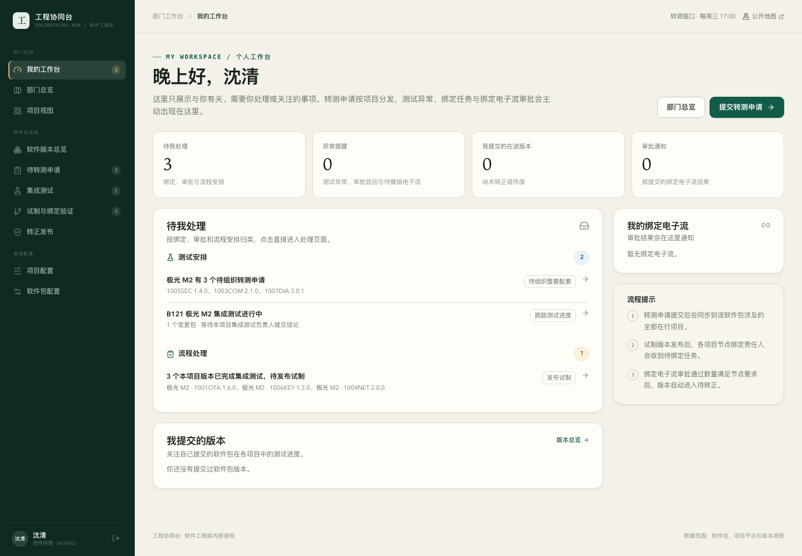
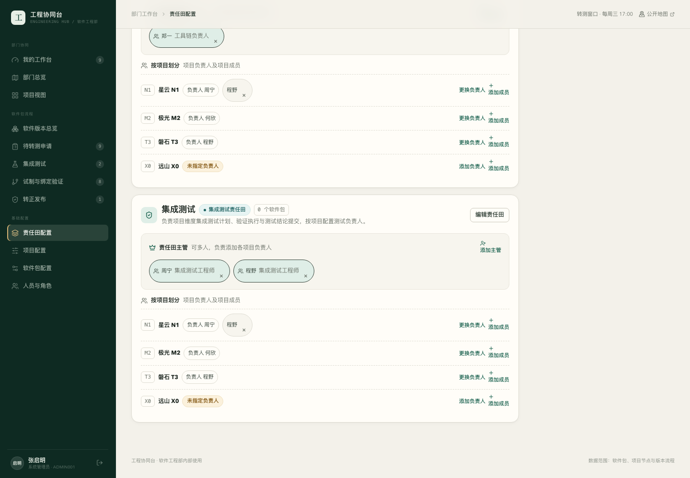
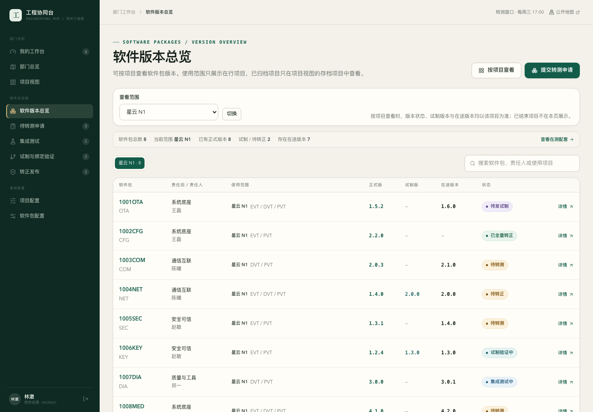
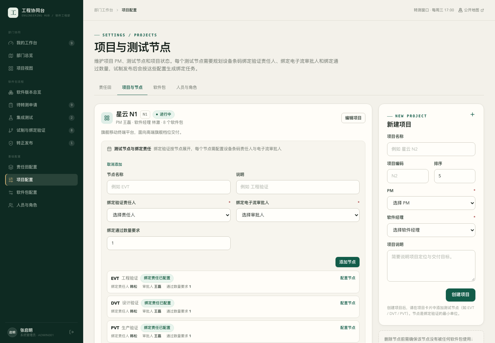
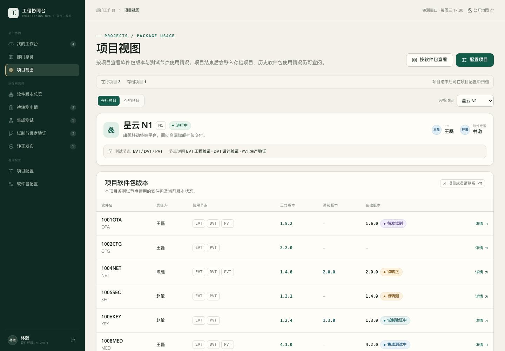

# 工程协同台

软件工程部内部工程工具站点，围绕“公开项目联系人 + 项目维度版本流程 + 集成测试责任田 + 项目节点硬件绑定验证”持续扩展。

当前版本已支持按项目组织转测与集成测试、项目软件经理隔离、责任田主管/负责人/成员三级管理、集成测试验证报告上传、试制与绑定电子流（支持多个设备条码、多次提交）、按项目维度试制与转正，以及软件包总览按项目查看。

## 界面预览

公开项目联系人首页（无需登录，只展示项目 PM 与软件经理）：


个人工作台（登录后首页，只展示自己的待办、异常和通知）：



部门总览：


责任田主管负责制（责任田主管 → 项目负责人 → 项目成员）：


集成测试责任田（项目级测试负责人配置）：



软件包总览（可按项目查看；使用范围不再展示已归档项目）：



按项目组织整套配套转测（无配套可选框，必须整套软件包一起转测）：


项目批次快照：


试制版本绑定验证（多设备条码、多电子流、按项目节点审批）：


项目节点绑定责任配置：



项目视图（在行 / 存档）：



移动端公开首页：


## 功能概览

### 公开项目联系人

- 只展示在行项目的项目名称、PM 和软件经理。
- 支持按项目、PM、软件经理搜索。
- 已归档项目不出现在公开首页。
- 不暴露内部版本、测试、绑定或审批数据。

### 个人工作台（登录后首页）

- 登录后进入 `/dashboard`，只展示当前用户需要处理或关注的事项。
- **测试异常**：自己提交的软件包在某个项目集成测试不通过或无法验证时，工作台显示对应项目异常提醒。
- **待我绑定**：试制版本发布后，本项目节点的绑定责任人会看到待提交设备条码的绑定任务。
- **待我审批**：绑定电子流审批人可以看到本项目待审批电子流。
- **项目软件经理待办**：仅显示自己负责项目的待转测申请、进行中批次、待发布试制、待转正事项。
- **集成测试责任田待办**：集成测试责任田的项目负责人会看到本项目待提交测试结论的批次。
- **审批通知**：绑定电子流通过或驳回后，提交人可在“我的绑定电子流”和最新通知中查看结果及审批意见。
- **待撤销提醒**：试制版本作废后，仍待审批的绑定电子流提交人收到“请撤销电子流”的提醒。

### 责任田主管负责制

- 管理员创建责任田并指定责任田主管；责任田主管可以多人。
- 责任田主管添加或更换各项目负责人。
- 项目负责人再为该项目添加项目成员。
- 责任田卡片完整展示主管、各项目负责人和项目成员。
- 项目负责人可修改本责任田软件包的责任信息；责任田主管也可以管理本责任田软件包责任信息。
- 集成测试是一个独立责任田，同样配置主管、项目负责人和成员，其项目负责人负责本项目集成测试结论。

### 转测申请：按项目分发

- 责任人或软件经理提交转测申请后，系统为该软件包当前使用的全部在行项目分别生成转测申请。
- 申请页面按项目分组；同一版本会在它使用的多个项目下分别出现。
- 项目软件经理只能看到自己负责项目的待转测申请。
- 同一软件包可以继续提交新版本，上一轮测试未结束不影响提交。
- 转测申请四项必填：软件包、版本号、变更说明、归档链接。

### 项目维度集成测试

- 每个集成测试批次属于一个项目，包含该项目**全部在用软件包**，不提供配套可选框。
- 每轮转测自动形成整套配套快照：当前正式版本、当前试制版本、上次本项目转测版本、本次转测版本及变化情况。
- 项目批次可由本项目软件经理发起和终止。
- 不同项目、同一项目均可同时存在多个测试批次，适配多台测试设备。
- 测试结论必须由本项目集成测试责任田负责人提交。
- 测试结论提交时必须**上传验证报告**（PDF、图片、Word、Excel、TXT 或 ZIP，≤15MB）。
- 报告通过鉴权文件接口访问，不能绕过系统直接公开下载。

### 项目维度试制与绑定

- 项目软件经理只能对本项目已完成集成测试的版本发布试制。
- 发布试制必须填写该项目的**发布试制电子流编号**。
- 试制发布后，系统只针对该项目使用的测试节点生成绑定验证任务，不再扩展到其他项目。
- 每个节点配置：
  - 设备条码绑定验证责任人；
  - 绑定电子流审批责任人；
  - 绑定通过数量要求（1-20，按审批通过条码数量计算）。
- 绑定责任人可以：
  - 在一个绑定电子流中添加多个设备条码；
  - 对同一节点多次提交绑定电子流。
- 绑定审批人在个人工作台或试制详情页审批通过/驳回；审批结果通知提交人。
- 节点审批通过的设备条码数量达到要求后节点通过；本项目全部节点通过后自动进入本项目待转正。
- 绑定验证不通过时，本项目软件经理可作废本项目试制版本；待审批电子流的提交人会收到撤销提醒。
- 不同项目对同一软件包版本的试制、绑定、转正状态互不影响。

### 项目维度转正发布

- 本项目所有测试节点绑定通过数量满足后，本项目软件经理填写转正电子流编号并发布正式版本。
- 一个软件包版本可以在 A 项目已转正、B 项目仍在测试或试制，互不覆盖。
- 正式版本、试制版本与作废版本历史均保留。
- 软件包总览按项目查看时，以该项目下的项目版本记录为准。

### 软件包总览

- 支持“全部在行项目”或指定项目查看。
- 使用范围只展示在行项目，不再展示已归档项目。
- 已归档项目的软件包记录在“项目视图 → 存档项目”中保留查看。
- 展示正式版本、全部当前试制版本、在途版本和使用范围。
- 试制版本列可展示同一软件包在多个项目/多个版本中的试制记录。
- 点击软件包打开右侧详情抽屉，查看版本历史、使用范围、节点绑定统计和责任信息。
- 责任田项目负责人、责任田主管、软件经理、管理员可修改软件包责任人、说明和启停状态。

### 项目与节点配置

- 项目必须配置 PM 和项目软件经理。
- 每个项目软件经理只能处理自己项目的转测、测试批次、试制、作废与转正。
- 测试节点必须配置绑定验证责任人与绑定电子流审批人，二者不能是同一人。
- 节点连接配置表单在展开时全宽显示，不再出现排版错位。
- 节点支持修改绑定责任、审批责任和绑定通过数量。
- 项目归档后移入存档项目：保留历史软件包使用与版本情况；不再参与新转测、测试和绑定。

### 评审中心

本版本仍不包含评审中心。评审专家角色作为预留角色保留。试制/转正由项目软件经理结合测试结论、绑定结果直接操作；评审场景待需求明确后重新实现。

## 核心流程

```text
责任人提交版本
   ↓
按软件包使用范围生成各项目转测申请
   ↓
本项目软件经理组织“整套配套”批次（必须包含全部软件包）
   ↓
本项目集成测试责任田负责人提交结论 + 上传验证报告
   ↓
本项目测试完成 → 本项目软件经理发布试制（填写试制电子流）
   ↓
仅为该项目节点生成绑定任务
   ↓
节点绑定责任人提交多个设备条码 / 多次绑定电子流
   ↓
节点审批人审批
   ↓
本项目全部节点条码通过数量满足 → 本项目待转正
   ↓
本项目软件经理填写转正电子流 → 本项目正式版本

绑定不通过：
本项目软件经理作废本项目试制版本 → 提醒待审批电子流提交人撤销
```

### 关键规则

- 转测、集成测试、试制、绑定、转正全部以**项目**为边界独立运行。
- 每个测试批次只属于一个项目，且必须覆盖该项目全部在用软件包。
- 同一项目、不同项目均允许并行测试批次数；上一轮未结束可提交新版本。
- 测试结论仅回写本项目对应的项目版本记录。
- 一个软件包版本在不同项目可以有不同生命周期状态。
- 试制绑定只覆盖本项目测试节点；不跨项目。
- 节点绑定通过数量按**审批通过的设备条码数量**计算，不按电子流条数计算。
- 一个电子流可包含多个设备条码；同一节点可多次提交电子流。
- 项目软件经理只看到并处理自己项目的待办和操作入口。
- 集成测试责任田负责人按项目提交结论，并上传验证报告。
- 管理员创建责任田并指定主管；主管维护项目负责人；项目负责人维护项目成员。

## 技术栈

| 技术 | 说明 |
| --- | --- |
| Next.js 16 App Router | 页面渲染、Route Group、Server Actions |
| React 19 + TypeScript | 服务端组件与少量交互客户端组件 |
| SQLite (`node:sqlite`) | 单机持久化，适合 < 1000 人的部门系统 |
| Tailwind CSS 4 + 自定义样式 | 统一视觉与响应式布局 |
| Playwright | 关键业务流程端到端测试 |
| Node.js >= 22.5 | 使用内置 `node:sqlite` |

## 快速开始

```bash
pnpm install
pnpm dev
```

打开 [http://localhost:3000](http://localhost:3000)。首次启动会自动创建数据库并写入演示数据（`data/toolkit.db`）。

### 演示账号

统一密码：`Demo@1234`

| 工号 | 姓名 | 角色 | 适合体验的操作 |
| --- | --- | --- | --- |
| ADMIN001 | 张启明 | 系统管理员 | 新建责任田、指定责任田主管、全部配置 |
| MGR001 | 林澈 | 软件经理 | 星云 N1：组织整套配套、发试制/作废、转正 |
| MGR002 | 沈清 | 软件经理 | 极光 M2：只处理 M2 项目流程 |
| MGR003 | 唐雅 | 软件经理 | 磐石 T3：只处理 T3 项目流程 |
| TEST001 | 周宁 | 集成测试 / 集成测试责任田主管 | 星云 N1 集成测试结论和验证报告 |
| TEST002 | 何欣 | 集成测试 / M2 集成测试负责人 | 极光 M2 集成测试结论 |
| TEST003 | 程野 | 集成测试 / T3 集成测试负责人 | 磐石 T3 集成测试结论 |
| OWNER001 | 王磊 | 软件包责任人 / 星云 N1 绑定审批人 | 提交 OTA/CFG/MED 转测，审批 N1 绑定电子流 |
| OWNER002 | 陈曦 | 软件包责任人 / 极光 M2 绑定审批人 | 提交 COM/NET 转测，审批 M2 绑定电子流 |
| OWNER003 | 赵敏 | 软件包责任人 / 磐石 T3 绑定审批人 | 提交 SEC/KEY 转测，审批 T3 绑定电子流 |
| OWNER004 | 郑一 | 软件包责任人 | 提交 DIA 转测 |
| VALID001 | 韩松 | 绑定验证员 / 硬件绑定责任人 | 提交设备条码与绑定电子流 |
| MEMBER001 | 许言 | 部门成员 | 只读查看内部工作台 |

> 演示账号只用于本地体验。正式部署前必须清空演示数据并修改所有初始密码。

### 演示数据状态

- 3 个在行项目：星云 N1（林澈）、极光 M2（沈清）、磐石 T3（唐雅）；1 个存档项目：远山 X0。
- 8 个软件包，名称为 4 位数字 + 3 位字母，例如 `1001OTA`。名称格式当前不强制校验。
- 责任田：系统底座、通信互联、安全可信、质量与工具、集成测试。
- B118（磐石 T3）测试不通过；B119/B122 测试通过；B120（N1）、B121（M2）测试中，演示多项目并行。
- 1001OTA 1.6.0 在 N1、M2 均已完成集成测试，待各项目软件经理发布试制。
- 1006KEY 1.3.0 在 N1 试制绑定中（节点 1/2 通过，存在待审批和被驳回电子流）；在 M2/T3 已具备试制条件。
- 1004NET 2.0.0 在 N1 已进入待转正，M2/T3 具备试制条件。
- 1003COM、1005SEC 有待组织转测申请。
- 集成测试责任田：主管周宁、程野，项目负责人 N1 周宁、M2 何欣、T3 程野。
- 韩松是全部在行项目节点的绑定责任人；王磊、陈曦、赵敏分别是各项目绑定审批人。

## 权限与角色

### 系统角色

| 角色 | 主要职责 |
| --- | --- |
| 系统管理员 | 创建责任田、指定责任田主管、全部配置和流程管理 |
| 软件经理 | 只处理自己被分配项目的转测组织、试制、作废、转正 |
| 集成测试 | 承担集成测试责任田工作；仅项目负责人/主管可提交结论 |
| 软件包责任人 | 提交本人软件包转测申请 |
| 绑定验证员 | 作为硬件团队绑定责任人提交设备条码和绑定电子流 |
| 部门成员 | 只读查看内部工作台 |
| 评审专家 | 预留角色，当前无流程操作 |

### 项目内责任

- 项目 PM：项目联系人。
- 项目软件经理：本项目版本流程负责人，只看到本项目待办。
- 集成测试责任田项目负责人：本项目集成测试结论与报告提交人。
- 节点绑定验证责任人：负责本项目节点设备条码电子流提交。
- 节点绑定电子流审批人：负责本项目节点电子流审批。
- 责任田主管：维护本责任田各项目负责人。
- 项目负责人：维护本责任田本项目成员，可修改本责任田软件包责任信息。

所有权限不仅在页面隐藏入口，Server Action 也会重新校验登录状态、角色、责任田层级、项目软件经理归属、项目节点归属和电子流关系。

## 常用命令

```bash
pnpm dev              # 开发模式
pnpm build            # 生产构建
pnpm start            # 启动生产服务（需先 build）
pnpm typecheck        # TypeScript 类型检查
pnpm lint             # ESLint
pnpm test:e2e         # 运行 Playwright E2E（使用独立 data/e2e.db）
pnpm test:e2e:full    # 构建后运行 E2E
pnpm db:seed          # 确保数据库表和演示数据存在
pnpm db:reset         # 删除数据库（谨慎！会清空全部数据）
pnpm admin:create -- <姓名> <工号> <密码>  # 创建或提升一个管理员
```

### 环境变量

参见 [`.env.example`](.env.example)。

| 变量 | 默认值 | 说明 |
| --- | --- | --- |
| `NEXT_PUBLIC_DEPARTMENT_NAME` | 软件工程部 | 部门名称展示 |
| `DATABASE_PATH` | `./data/toolkit.db` | SQLite 文件路径 |
| `SESSION_COOKIE_SECURE` | 生产环境 `true` | HTTPS 部署保持 true；本地 HTTP 生产验收设 false |
| `TOOLKIT_SKIP_SEED` | `0` | 设为 `1` 时不写入演示数据 |

## 测试与验证

E2E 使用独立 `data/e2e.db`，启动时清空该文件，不会污染开发/演示数据库。当前覆盖 **13 个端到端场景**：

1. 公开首页只展示项目 PM 和软件经理，支持按经理搜索。
2. 未登录访问内部页面跳转登录，错误密码有提示。
3. 注册、自动登录、角色限制与退出登录。
4. 公开首页到内部工作台。
5. 移动端可见退出登录入口。
6. 责任田主管 → 项目负责人 → 项目成员三级管理权限。
7. 项目节点绑定配置表单排版与通过数量修改。
8. 个人工作台只展示本项目软件经理待办、集成测试责任田任务、异常与绑定提醒。
9. 整套配套转测无可选框、批次必须整套、软件经理不能提交测试结论。
10. 集成测试责任田负责人提交结论并上传验证报告。
11. 项目试制、多个设备条码/多个电子流、节点审批、项目转正。
12. 作废项目试制版本后，绑定责任人收到撤销提醒并撤销电子流。
13. 软件包总览按项目查看、使用范围排除存档项目，存档项目仍在项目视图保留记录。

运行：

```bash
pnpm exec playwright install chromium   # 首次运行测试前安装浏览器
pnpm build
pnpm test:e2e
```

最近一次结果：**13 passed**，构建、TypeScript 类型检查与 ESLint 均通过。

## 目录结构

```text
app/
  page.tsx                    # 公开项目联系人首页
  (auth)/                     # 登录、注册
  (workspace)/
    dashboard/                # 个人工作台
    overview/                 # 部门总览
    packages/                 # 软件包总览（支持按项目）
    submissions/              # 按项目分发的转测申请
    integration/              # 项目批次列表、整套配套、测试结论与报告上传
    trial/                    # 项目试制、节点绑定、电子流
    formal/                   # 项目转正发布
    projects/                 # 在行/存档项目视图
    settings/                 # 责任田、项目节点、软件包、人员
  api/packages/[id]/          # 抽屉详情接口
  api/reports/[id]/           # 鉴权验证报告下载
components/                   # UI、表单、导航、批次编辑器、抽屉、多条码电子流表单
lib/
  schema.ts                   # SQLite 表结构
  seed.ts                     # 演示数据
  queries.ts                  # 通用读取查询（含项目维度软件包总览）
  workflow-queries.ts         # 项目测试、试制、绑定、个人工作台查询
  workflow.ts                 # 转测、批次、试制、绑定、报告、转正服务
  access.ts                   # 责任田层级与集成测试责任田权限
  permissions.ts              # 角色/项目软件经理/责任田权限判断
  settings.ts                 # 基础配置与责任田层级维护
tests/e2e/                    # Playwright 端到端测试
scripts/                      # 重置数据库、种子、创建管理员
docs/screenshots/             # README 截图
data/                         # SQLite 数据文件与上传报告（部署需持久化）
```

## 部署注意事项

- 当前为单机 SQLite 方案，适合部门级 < 1000 人使用；部署时必须持久化 `data/` 目录（含 `data/uploads/reports`）。
- 生产环境请通过 HTTPS 访问，并保持 `SESSION_COOKIE_SECURE=true`。
- 数据库升级或清空演示数据前先备份 `data/toolkit.db` 与 `data/uploads/`。
- 试制/转正电子流编号由用户填写并保存；绑定电子流在本系统生成编号并完成审批，尚未对接企业 OA/BPM。
- 个人工作台通知为系统内派生展示，暂未接入邮件、短信或即时通讯推送。
