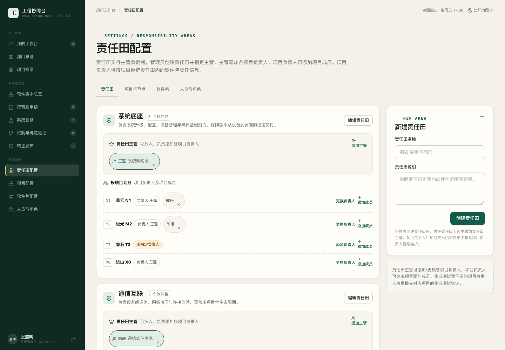
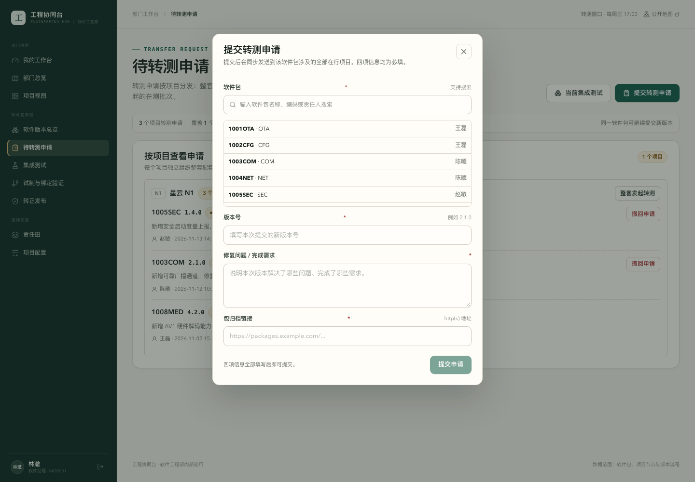
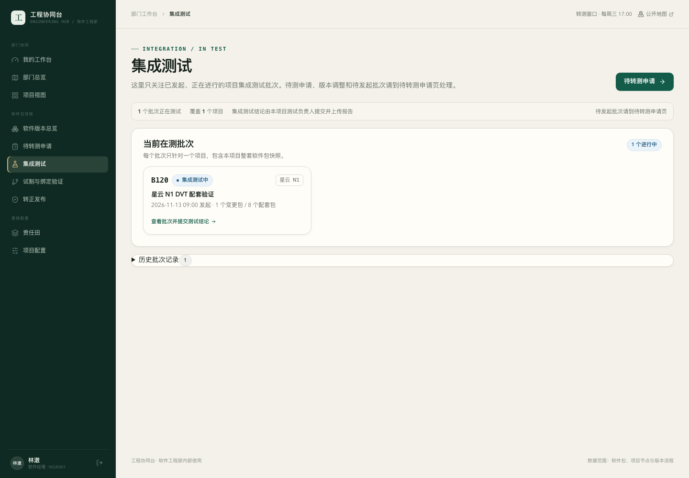
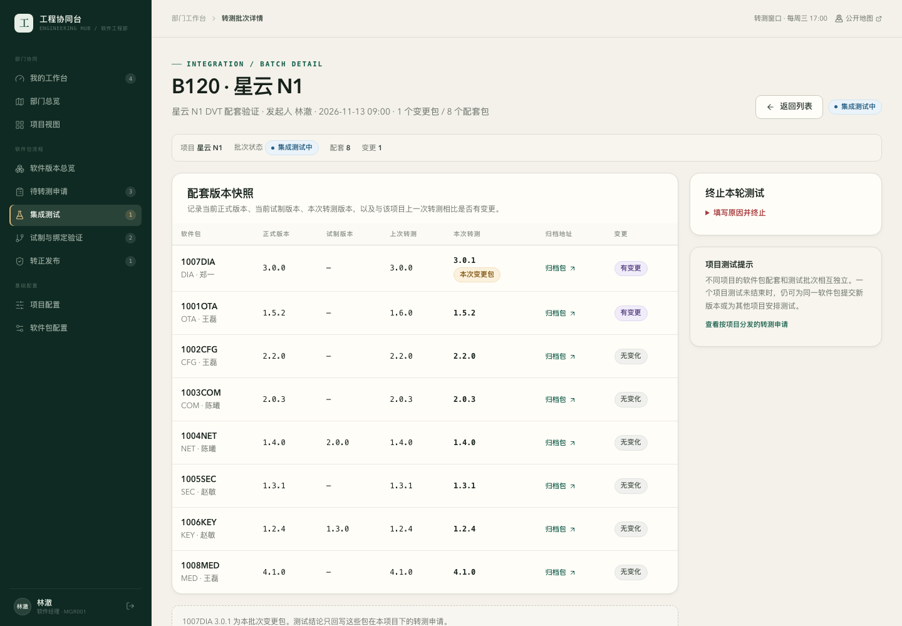
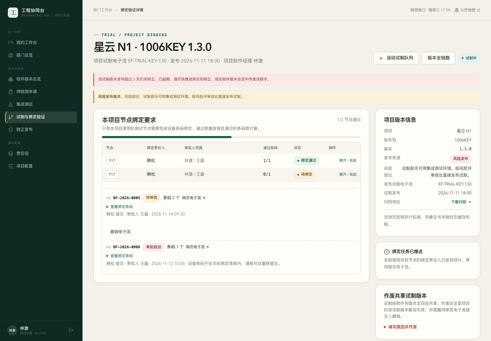
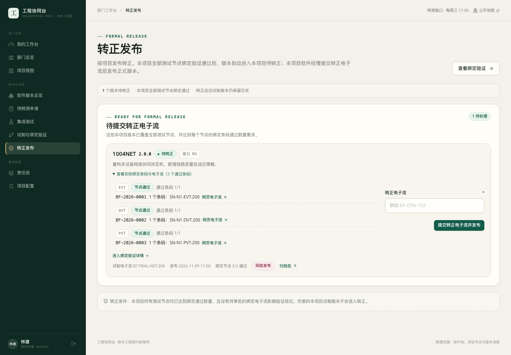
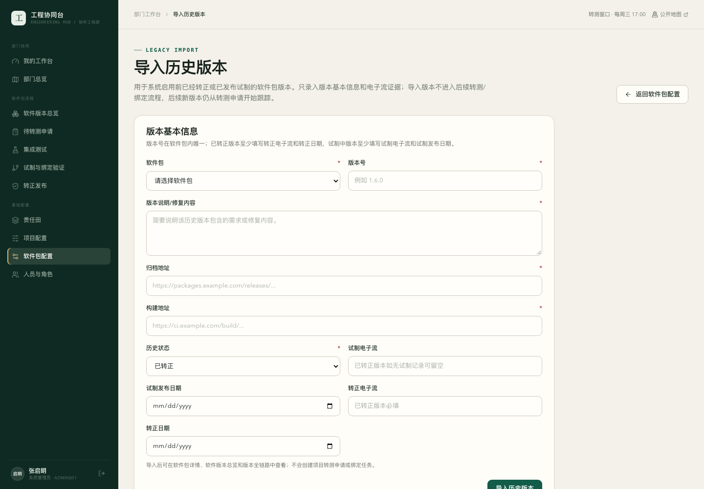
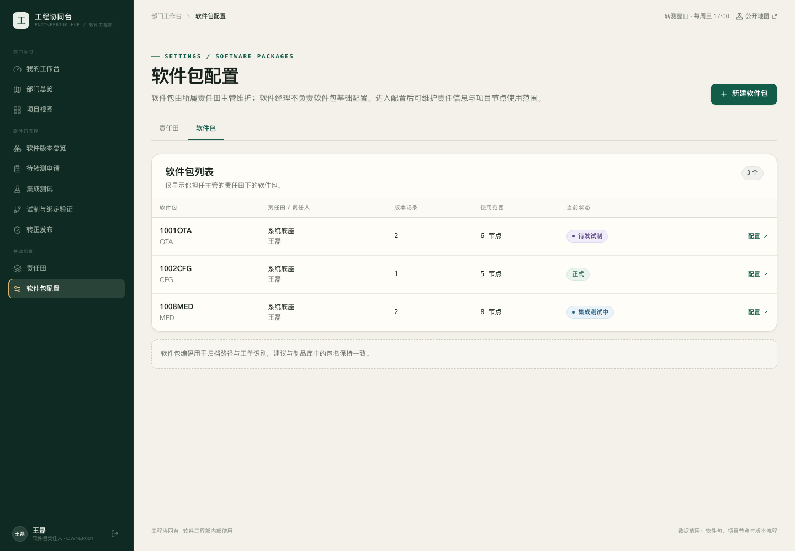

# 工程协同台

软件工程部内部工程工具站点，围绕“公开项目联系人 + 项目维度版本流程 + 集成测试责任田 + 项目节点硬件绑定验证”持续扩展。

> 跨页面业务联动、状态机和场景说明见：[业务逻辑与联动关系](docs/业务逻辑与联动关系.md)。

## 使用者上手指南

[从转测申请到正式发布（截图版 HTML）](docs/workflow-guide/index.html)按业务分工标注操作入口、办理条件和处理下一步的位置。在文件页点击 **Download raw file**，保存后用浏览器打开。截图和标注已内置，可离线查看。

转测和集成测试按项目管理，试制和转正按软件包版本跨项目共享。登录后在项目总览查找项目并了解产品阶段。进入有流程权限的项目后，左侧导航和流程页面沿用该项目范围。软件经理可选择本轮转测的软件包，确认待发起批次的配套快照，并在部分项目未验收时登记风险后提前试制。版本全链路有独立入口，可搜索版本并回查验收、绑定和转正证据。

## 界面预览

<details>
<summary>查看改版前的界面截图</summary>

以下截图记录改版前的页面布局和操作入口。

公开项目联系人首页（无需登录，只展示项目 PM 与软件经理，支持多人）：


个人工作台（登录后首页，只展示自己的待办、异常和通知）：


项目总览展示全部项目的基础资料，点击项目名进入项目页面。下图为改版前的界面。


责任田配置（所有成员可查看，管理员通过弹窗新建责任田）：



集成测试责任田（项目级测试负责人配置）：


待转测申请（按项目展示待测申请与待发起批次，整套转测在本页完成）：


提交转测申请（软件包支持搜索，五项信息全部填写后才可提交）：



整套配套版本选择（默认选中可用版本，可下拉改选历史版本）：


集成测试（在测与历史批次）：



项目批次快照与进展说明：



待发布试制（共享试制、风险发布、放弃试制、超期提示）：


绑定验证详情（节点表格、超期提示与作废入口）：



绑定验证（节点按表格行展示，批量条码与网页电子流可展开核验）：


转正发布（填写转正电子流，先核对实际绑定条码和网页电子流）：



历史版本导入（补录系统启用前已有转正/试制记录）：



项目节点绑定责任配置（主审批人与审批人范围紧凑展示）：


软件包配置（由责任田主管维护）：



软件包总览（逐列筛选；使用范围始终展示全部在行项目）：


项目工作区集中展示本项目的转测、集成测试、试制绑定和待转正信息。下图为改版前的界面。


版本全链路（转测、批次/报告、共享试制、全部项目绑定条码/电子流、转正）：


移动端公开首页：


</details>

## 功能概览

### 公开项目联系人

- 只展示在行项目的项目名称、PM 和软件经理。
- 一个项目可以配置多位 PM 和多位软件经理，联系人卡片逐人展示。
- 支持按项目、PM、软件经理姓名或工号搜索。
- 已归档项目不出现在公开首页。
- 不暴露内部版本、测试、绑定或审批数据。

### 个人工作台（登录后首页）

- 默认登录后进入 `/dashboard`。从受保护的内部链接进入时，登录会回到原页面并保留项目范围与筛选条件。
- 登录后左上角显示当前账号分配的责任田。多项同时显示，未分配时显示「未分配责任田」。
- 登录后在顶部选择「修改密码」。填写当前密码，并输入两次一致的 8–72 字符新密码。保存后会退出该账号在所有设备上的登录，请使用新密码重新登录。
- 工作台待办直接打开相应项目、待发起批次、测试或绑定详情。异常、我提交的版本和审批通知可从顶部快速定位。
- **测试异常**：自己提交的软件包在某个项目集成测试不通过或无法验证时，工作台显示对应项目异常提醒。
- **节点绑定待办**：推送后，绑定责任人可提交设备条码。已审批条码达标后，软件包责任人、该节点所属项目的软件经理和管理员收到「确认节点通过」待办。
- **待我审批**：绑定电子流审批人可以看到本项目待审批电子流。
- **项目软件经理待办**：仅显示自己负责项目的待转测申请、进行中批次、待发布试制、待转正事项。
- **集成测试责任田待办**：集成测试责任田的项目负责人会看到本项目待提交测试结论的批次。
- **审批通知**：绑定电子流通过或驳回后，提交人可在“我的绑定电子流”和最新通知中查看结果及审批意见。
- **通知已读**：点击异常提醒或最新通知后会自动标记已读，刷新/返回工作台后该消息消失。
- **待撤销提醒**：试制版本作废后，仍待审批的绑定电子流提交人收到“请撤销电子流”的提醒。

### 责任田主管负责制

- **所有成员都可以查看责任田页面**，包括主管、各项目负责人和项目成员。
- 只有管理员可以新建责任田和指定责任田主管。通过页头按钮打开新建表单。
- 责任田主管添加或更换各项目负责人。
- 项目负责人再为该项目添加项目成员。
- 从责任田目录进入详情，按项目名称或代号筛选并分页。项目负责人和成员在表格内查看，添加时在弹窗里按姓名或工号搜索。
- 软件包配置由责任田主管或管理员维护。
- 集成测试是一个独立责任田，同样配置主管、项目负责人和成员，其项目负责人负责本项目集成测试结论。

### 转测申请与整套批次

- 责任田主管、项目负责人和成员可以提交所属责任田的启用软件包，管理员可以处理全仓软件包。提交后为该包当前使用的全部在行项目分别生成申请。
- 待转测申请按项目分组。列表显示软件包编码、版本、提交人、提交时间和归档地址。同一版本会在它使用的多个项目下分别出现，右侧详情可查用途和历史版本。
- 项目软件经理只能看到自己负责项目的待转测申请。
- 同一软件包可以继续提交新版本，上一轮测试未结束不影响提交。
- 转测申请五项必填：软件包、版本号、变更说明、归档链接、构建地址；软件包支持搜索，未填完五项时提交按钮不可用。
- 软件经理可先在待转测表格勾选本轮版本，再进入「准备批次」核对配套。未勾选的申请留到下轮。保存后打开批次快照，核对无误再选择「发起转测」。
- 未发起的批次可从转测页的「待发起批次」继续处理。未选中的软件包仍留在待转测队列。申请表可按表头筛选，被隐藏的已选项会保留并提示数量，创建批次前可在完整配套清单中核对。
- 每轮转测默认沿用上次本项目转测版本；有新增转测申请的软件包默认新版本，其余包可下拉改选历史版本。
- 如果所选版本在本项目试制阶段已作废，版本选项会标记“本项目已作废”并显示风险提示。

### 项目维度集成测试

- 集成测试默认展示在测批次，待测申请、版本调整和待发起批次在待转测申请页处理。批次详情根据状态返回待发起、在测或历史队列。
- 每个批次属于一个项目。在申请表暂缓新版本时，准备页预选该包上次仍有效的转测版本。没有可沿用版本时该包本轮缺席。准备页可以明确取消纳入任一软件包，新申请仍在待转测队列。
- 快照保留所选软件包的当前正式版本、当前试制版本、上次转测版本、本次转测版本及变化情况。
- 项目批次由本项目软件经理在批次详情发起或终止。集成测试责任田有权限的成员可提交进展与结论。
- 集成测试负责人可对批次随时提交进展说明；进展时间线对项目相关成员可见。
- 不同项目、同一项目均可同时存在多个测试批次，适配多台测试设备。
- 测试结论必须由本项目集成测试责任田负责人提交。
- 测试结论提交时必须**上传验证报告**（PDF、图片、Word、Excel、TXT 或 ZIP，≤15MB）。
- 报告通过鉴权文件接口访问，不能绕过系统直接公开下载。
- 已完成和已终止的批次在集成测试的「历史批次」标签。历史表格支持按列筛选，服务端对项目范围内的全部历史先筛选再分页。从历史详情返回会恢复筛选和页码。

### 共享试制与绑定推送决策

- 待发布试制按共享版本聚合，绑定验证按版本和项目逐行展示，包含关联的转测批次和提交人。两个队列各自使用表头下拉筛选、排序和分页，查看详情后可恢复各队列的条件。
- 两张表输入筛选条件和切换每页条数时会自动刷新。待发布试制行内的“详情”可查看验收结论、报告和已登记的风险原因。进入详情后返回队列会恢复筛选、排序和页码。
- 全部在行使用项目均有通过的集成测试批次时进入普通试制。需要提前试制时，本项目软件经理或管理员可在待转测申请、在测批次或未通过的批次详情登记风险原因。旧版本的通过记录缺少批次证据时，可从版本全链路登记。登记后才进入风险队列，发布弹窗使用已登记的原因。
- 并行测试保留原批次、验收结论和报告。已安排的测试完成前暂停转正。提交与软件包相关的失败结论时，选择受影响版本；其中已风险试制的版本会跨项目作废，节点绑定关闭，待审批及已通过的电子流提交人会收到撤销提醒。
- 任意使用项目的软件经理填写 HTTP(S) 电子流网址和文字评审纪要后发布一次试制，全部项目版本同步进入 TRIAL；其他项目不再需要发布试制。
- 发布后只生成绑定要求，**不会自动给绑定责任人推送待办**；软件经理必须在试制详情中明确：
  - 推送绑定任务：全部使用项目节点进入绑定责任人待办；
  - 无需绑定：填写理由后关闭全部节点绑定，待已安排的验收结束后进入待转正；
  - 放弃试制：填写理由并作废该版本，不再使用。
- 未推送前绑定责任人看不到待办，也不能提交电子流。
- 节点展开后显示已有的绑定记录和条码。新增电子流使用弹窗，支持批量录入设备条码。推送后，本项目软件经理或节点绑定责任人可填写理由，登记单节点免绑。
- 提交绑定电子流必须附带网页电子流地址；提交人可撤销待审批电子流，审批人不能审批自己提交的电子流。
- 全部使用项目的节点已达标或登记免绑，且已安排的测试已结束时，所有项目版本同步进入 PENDING_FORMAL。
- 共享试制作废会同步作废全部项目版本，并提醒全部项目待审批电子流提交人撤销。
- 发布试制后超过软件包配置的“试制超期天数”仍未转正，对应项目概览和流程页会显示“已超期”。

### 无需绑定、放弃试制与版本作废

- 试制发布后软件经理可以填写理由，跳过整个版本的绑定。转正页可查看免绑原因。
- 从待发布试制行打开“放弃”并填写结论。普通试制放弃后版本作废。放弃本次风险试制会移出风险队列，已有转测及集成测试继续。
- 已发试制、待转正或已转正的版本可在版本全链路页填写作废原因并作废；作废后全部项目同步失效，不再作为可用版本。
- 历史证据（批次、报告、试制/转正电子流、绑定条码）保留可追溯。

### 试制超期提醒

- 软件包配置与新建软件包表单可设置“试制超期天数”（1-365 天，默认 7 天）。
- 超过期限仍处于 TRIAL/PENDING_FORMAL 的共享试制版本会显示“已超期”。
- 项目概览的流程卡片、试制与绑定验证页面、绑定详情和转正发布页均会提示。

### 共享转正发布

- 版本进入待转正后，从「节点绑定」移到「转正发布」。转正核对页可打开原节点绑定详情，继续核对记录或处理待审批电子流。
- 转正页按软件包版本聚合，一个版本只出现一次，展示全部使用项目。
- 全部项目均为 PENDING_FORMAL 时，由任意使用项目的软件经理填写一次转正电子流网址（HTTP(S)）和文字评审纪要。系统会再次检查节点绑定和已安排的集成测试。
- 所有项目版本同步 FORMAL；其他项目不再需要、也不能重复转正。
- 转正前从列表进入该版本的转正详情，可核对各项目的节点、通过条码、网页电子流及验收或风险结论。
- 可从转正页进入版本全链路，回看完整证据。

### 软件包总览

- 支持按项目筛选软件包列表。
- 搜索栏可快速查软件包、版本或责任人，列表支持分页。关闭详情或从浏览器返回时会保留列表条件。
- 点击表头的筛选按钮，可按软件包、编码、责任田和责任人、使用项目和节点、正式版、试制版、在途版本及状态组合筛选。使用项目和节点须在同一条项目使用记录中匹配。
- 筛选项目只限制列表范围，**使用范围列始终展示全部在行项目**，便于判断软件包是否跨项目使用。
- 已归档项目可在项目总览按「已结束」查找。获授权的用户可在项目工作区查阅历史软件包使用记录。
- 软件包详情分为「概览」「版本历史」「使用范围」。可在版本历史查找归档地址、构建地址和全链路证据，也可从总览表格直达节点列表。版本和节点列表支持在详情中搜索和分页。
- 责任田主管、责任田项目负责人和管理员可修改职权范围内的软件包责任信息。

### 历史版本导入

- 软件包配置新增“导入历史版本”，用于系统启用前已存在转正/试制记录的版本。
- 录入软件包、版本号、说明、归档地址、构建地址、历史状态和电子流/日期。
- 导入版本只作为历史基本信息和证据展示，不会创建转测、绑定任务；后续新版本仍从转测申请开始完整跟踪。

### 软件包配置

- 软件包配置由**责任田主管**维护，系统管理员可维护全部责任田。
- 软件经理访问软件包配置会被拒绝，软件包详情抽屉中的责任信息编辑入口也不会显示。
- 责任田主管只能看到并维护自己责任田下的软件包。
- 支持新建软件包、维护名称/编码/责任人/所属责任田/说明、试制超期天数，并配置项目测试节点使用范围。
- 在软件包配置、责任田、人员与角色和项目总览的表头点击筛选按钮，按该列输入关键字、勾选值或填写数字范围，再点击「应用」。同一字段的多选匹配任一值，不同字段的条件同时生效。可清除单列或全部筛选，每页条数在表格下方切换。
- 软件包名称用于描述用途。新增或修改的编码使用 5 位数字和 3 位字母，例如编码 `10001OTA`、名称「OTA 升级服务」。历史软件包的已有编码可继续使用，例如 `1001OTA`。

### 项目与节点配置

- **只有管理员可以新增项目**。项目配置先按名称或代号搜索，进入单个项目详情维护阶段、联系人和节点。软件经理仅可修改被分配的项目，服务端同样校验。
- 项目编码支持中文、空格和标点，保存时去掉首尾空白并保留输入的大小写。编码必填且不可重复。
- 新建与编辑项目都可设定 TR1 至 TR6 或「已结束」。新建项目及升级前已存在的项目默认 TR1。产品阶段与流程状态独立，设为「已结束」时，项目的流程状态仍按「流程状态」字段执行。
- 新增、编辑项目时可按姓名或工号搜索并多选 PM 和软件经理。每位软件经理都具有该项目的流程权限。
- 每个项目软件经理只能处理自己项目的转测、测试批次、试制、作废与转正。
- 测试节点必须配置绑定验证责任人与主审批人，二者不能是同一人；主审批人自动进入审批人范围，还可增加其他审批人。
- 项目详情列出测试节点、绑定责任人、主审批人和通过数量。点击任一节点可进入独立配置页。
- 节点支持修改绑定责任、主审批人、审批人范围和绑定通过数量。
- 节点配置页可按姓名或工号添加审批人，通过确认弹窗移除人员。
- 编辑项目不再显示排序字段，排序由系统保留。
- 在项目配置维护阶段 TR1–TR6 和已结束。旧项目默认 TR1，归档项目在总览显示已结束。阶段和流程状态独立维护。归档项目保留历史软件包使用与版本，退出新转测、测试和绑定。

### 项目总览与项目工作区

- 项目总览列出所有项目的名称、编码、阶段和联系人。按项目名称或编码、阶段、PM 和软件经理逐列筛选，支持每页 10、25 或 50 条。
- 点击项目进入 `/projects/[id]` 项目工作区。
- 主侧栏提供我的工作台、项目总览及获授权的配置入口。进入有流程权限的项目后，侧栏切换为当前项目的软件版本总览、待转测申请、集成测试、试制与绑定验证、转正发布、版本全链路。顶部显示项目名并提供返回项目总览的入口。
- 项目工作区聚合：
  - 项目信息、多 PM/多软件经理、节点；
  - 全部软件包及全局项目使用范围（含存档项目标记）；
  - 本项目待转测申请；
  - 集成测试批次和历史；
  - 待发试制、绑定中版本；
  - 待转正版本；
  - 项目全部版本流程记录，可进入版本全链路。
- 项目页面单独校验流程权限。访问未分配的项目时，可查看项目基本资料。
- 旧 `/projects` 入口兼容跳转到项目总览。

### 版本全链路

- `/versions` 按表格展示版本记录。点击表头的筛选按钮，组合筛选软件包、版本号、版本状态和提交日期。筛选和每页条数变更会返回第一页，已有排序和项目范围随列表保留。
- 点击“全链路追溯”可打开版本详情标签。切回“版本列表”时保留搜索、筛选、排序和分页，也可继续打开其他版本进行比对。
- `/versions/[id]` 提供任意版本的完整质量回溯。
- 展示全部使用项目的转测/验收状态、集成测试批次结论/报告、试制电子流/风险结论、绑定节点/条码/电子流/审批、转正电子流。
- 可从软件包抽屉版本历史、批次快照、试制详情、转正页进入。

### 稳定性与性能

- 移除了全局布局中每次导航都重复计算全部工作台统计的逻辑，只在实际进入个人工作台时查询数据。
- 关闭侧边导航的自动预取，避免一次导航触发大量并发 RSC 请求造成 CPU 峰值。
- 切页时保留当前内容。等待超过约 100 毫秒时，侧栏、窄屏菜单或返回项目总览的入口显示加载状态。
- 为常用查询设置索引。
- 软件包详情由服务端预加载。项目总览和项目工作区使用服务端路由，降低对客户端水合的依赖。

### 评审中心

共享试制和转正由使用该软件包的项目软件经理结合项目测试结论、风险和绑定结果办理。

## 核心流程

```text
责任人提交版本（填写构建地址）
   ↓
按软件包使用范围生成各项目转测申请
   ↓
各项目软件经理选择本轮配套、发起集成测试
   ↓
验收全部通过则正常发布，有缺项时需登记风险结论
   ↓
任意项目软件经理发布一次全项目共享试制
   ↓
软件经理决定：推送绑定 / 无需绑定直接待转正 / 放弃试制
   ↓
需要绑定时：绑定责任人提交条码/网页电子流，个别节点可登记免绑
   ↓
节点确认通过或免绑，且已安排的测试结束 → 同步待转正
   ↓
任意项目软件经理填写一次转正电子流 → 全部使用项目同步正式版本
   ↓
超期提醒、版本作废、历史版本补录、全链路追溯
```

### 关键规则

- 转测批次默认沿用上次本项目转测版本，有新增转测的包默认新版本，也可在表格下拉框改选历史版本。
- 测试结论、进展说明、验证报告必须由对应项目的集成测试责任田负责人提交；集成测试主管可查看全部项目。
- 通知点击后自动已读并消失。
- 绑定电子流审批人须在节点审批人范围内选择；提交人可撤销自己的待审批电子流。
- 一个项目可配置多位 PM、多位软件经理；软件经理权限按项目成员关系判定。
- 转测申请必须五项信息完整才可提交；软件包选择支持搜索，构建地址必填。
- 待发布试制展示集成批次与验收结论。验收未完成、失败或缺少批次时须登记风险结论。
- 绑定电子流必须附带可访问的网页电子流地址。
- 编辑项目不再需要维护排序；新建项目仅管理员可操作。
- 软件包配置仅责任田主管和系统管理员可操作。
- 待发起批次只在待转测申请页展示；集成测试页只展示在测批次。
- 转测申请、集成测试批次、项目工作区按项目隔离；试制/转正按软件包版本全项目共享。
- 每个测试批次只属于一个项目，包含本轮选中的在用软件包和至少一份待测申请。
- 同一项目、不同项目均允许并行测试批次；上一轮未结束可提交新版本。
- 测试结论记录到本项目。风险试制期间，如确认某版本导致测试失败，该版本在全部使用项目同步作废。
- 共享试制发布一次，为全部使用项目生成节点绑定要求。已审批条码达到要求后，由软件包责任人、该节点所属项目的软件经理或管理员核对外部验证结果并确认节点通过。
- 在行节点全部确认通过或登记免绑，且已安排的测试结束后，在行项目一起进入待转正。新增审批通过或撤销已通过的电子流时，受影响节点需重新确认。
- 共享转正发布一次，全部使用项目同步为正式版本。
- 项目总览展示所有项目的基础资料。软件经理可查看所负责项目的转测、测试、绑定和发布记录，兼任职责按对应分工授权。
- 软件包总览按项目筛选时，使用范围仍展示全部在行项目。
- 版本全链路可回溯转测、验收、试制、绑定条码、电子流和转正。
- 项目软件经理只看到并处理自己项目的待办和操作入口。
- 管理员创建责任田并指定主管；主管维护项目负责人；项目负责人维护项目成员。

## 技术栈

| 技术 | 说明 |
| --- | --- |
| Next.js 16 App Router | 页面渲染、Route Group、Server Actions |
| React 19 + TypeScript | 服务端组件与少量交互客户端组件 |
| SQLite (`node:sqlite`) | 单机持久化，适合 < 1000 人的部门系统 |
| Tailwind CSS 4 + 自定义样式 | 统一视觉与响应式布局 |
| Playwright | 关键业务流程端到端测试 |
| Node.js >= 22.5 | 使用内置 `node:sqlite`，22.13 起默认启用 |

## 快速开始

```bash
pnpm install
pnpm dev
```

打开 [http://localhost:3000](http://localhost:3000)。首次启动会自动创建数据库并写入演示数据（`data/toolkit.db`）。

Node.js 22.5 至 22.12 需要为 Node 进程启用 `--experimental-sqlite`，并选择兼容该版本的 pnpm。项目完整回归使用 Node.js 24.19.0 和 pnpm 11.19.0。pnpm 11.19.0 本身需要 Node.js 22.13 或更高版本。 [Node.js SQLite 文档](https://nodejs.org/download/release/v22.12.0/docs/api/sqlite.html) · [22.13.0 发布说明](https://nodejs.org/en/blog/release/v22.13.0)

### 演示账号

统一密码：`Demo@1234`

| 工号 | 姓名 | 演示分工 | 适合体验的操作 |
| --- | --- | --- | --- |
| ADMIN001 | 张启明 | 系统管理员 | 新建责任田、指定责任田主管、全部配置 |
| MGR001 | 林澈 | 软件经理 | 星云 N1：在待转测页发起整套配套、发试制/作废、转正 |
| MGR002 | 沈清 | 软件经理 | 极光 M2：只处理 M2 项目流程 |
| MGR003 | 唐雅 | 软件经理 | 磐石 T3：只处理 T3 项目流程 |
| TEST001 | 周宁 | 集成测试 / 集成测试责任田主管 | 星云 N1 集成测试结论和验证报告 |
| TEST002 | 何欣 | 集成测试 / M2 集成测试负责人 | 极光 M2 集成测试结论 |
| TEST003 | 程野 | 集成测试 / T3 集成测试负责人 | 磐石 T3 集成测试结论 |
| OWNER001 | 王磊 | 系统底座责任田主管 / 软件包责任人 / N1 绑定审批人 | 维护系统底座软件包配置，提交 OTA/CFG/MED 转测，审批 N1 绑定电子流 |
| OWNER002 | 陈曦 | 通信互联责任田主管 / 软件包责任人 / M2 绑定审批人 | 维护通信互联软件包配置，提交 COM/NET 转测，审批 M2 绑定电子流 |
| OWNER003 | 赵敏 | 安全可信责任田主管 / 软件包责任人 / T3 绑定审批人 | 维护安全可信软件包配置，提交 SEC/KEY 转测，审批 T3 绑定电子流 |
| OWNER004 | 郑一 | 软件包责任人 | 提交 DIA 转测 |
| VALID001 | 韩松 | 节点绑定责任人 | 提交设备条码与绑定电子流 |
| MEMBER001 | 许言 | 普通账号 | 浏览项目总览和联系人 |

> 演示账号只用于本地体验。正式部署前必须清空演示数据并修改所有初始密码。

### 演示数据状态

- 3 个在行项目：星云 N1（林澈）、极光 M2（沈清）、磐石 T3（唐雅）；1 个存档项目：远山 X0。
- 8 个软件包，名称为 4 位数字 + 3 位字母，例如 `1001OTA`。名称格式当前不强制校验。
- 责任田：系统底座、通信互联、安全可信、质量与工具、集成测试。
- B118（磐石 T3）测试不通过；B119/B122 测试通过；B120（N1）、B121（M2）测试中，演示多项目并行。
- 1001OTA 1.6.0 在 N1/M2 均完成集成测试，待发布一次共享试制；待发布卡片展示批次和通过结论。
- 1001OTA 1.6.1 在 N1/M2 缺少验收批次，可由相应项目软件经理从全链路登记风险原因。1.6.2 关联两个通过批次，演示普通试制和放弃。
- 1004NET 2.0.0 在 N1/M2/T3 已全部完成绑定验证，按共享版本进入待转正，转正页按版本聚合展示全部项目条码。
- 1006KEY 1.3.0 在 N1/M2/T3 已按共享版本发布试制；N1 节点 1/2 通过，存在待审批/被驳回电子流，M2/T3 绑定待处理。
- 1003COM、1005SEC 有待安排转测申请；可在待转测申请页发起整套批次。
- B120/B121 已有集成测试进展说明；节点审批人范围包含项目 PM 和项目软件经理。
- B122 等批次记录用于验证历史批次查询；等待发起的批次在待转测申请页处理。
- 集成测试责任田：主管周宁、程野，项目负责人 N1 周宁、M2 何欣、T3 程野。
- 韩松是全部在行项目节点的绑定责任人；王磊、陈曦、赵敏分别是各项目绑定审批人。

## 权限与角色

### 系统角色

| 角色 | 主要职责 |
| --- | --- |
| 系统管理员 | 管理账号、责任田、项目和软件经理指派，按流程规则管理业务 |
| 普通账号 | 查看项目基础资料，按实际指派处理业务 |

### 项目内责任

- 项目 PM：项目联系人，可多人。
- 项目软件经理：由管理员指派，可多人。每位可以管理负责项目的流程，维护项目阶段、PM 和测试节点。
- 集成测试责任田项目负责人：本项目集成测试结论与报告提交人。
- 节点绑定责任人：负责提交设备条码和绑定电子流。
- 节点通过确认：由软件包配置中的当前责任人、该节点所属项目的软件经理或管理员执行。
- 指定电子流审批人：处理指定给自己的记录。提交人不得自审。
- 责任田主管：维护本责任田各项目负责人和软件包配置。
- 软件经理：维护本项目版本流程，不配置软件包基础信息。
- 项目负责人：维护本责任田本项目成员，可修改本责任田软件包责任信息。

审批列表、直接打开的业务详情和报告下载按业务分工校验。一个普通账号可同时承担多个项目或节点的职责。升级旧库时，原有非管理员账号归并为普通账号，人员 ID、指派和审批记录保留。

## 常用命令

```bash
pnpm dev              # 开发模式
pnpm build            # 生产构建
pnpm start            # 启动生产服务（需先 build）
pnpm typecheck        # TypeScript 类型检查
pnpm lint             # ESLint 和架构检查
pnpm test:e2e         # 运行 Playwright E2E（使用系统临时目录中的独立数据）
pnpm test:e2e:full    # 构建后运行 E2E
pnpm db:seed          # 初始化数据库，按启动配置决定是否写入演示数据
pnpm db:reset         # 删除数据库（谨慎！会清空全部数据）
pnpm admin:create -- <姓名> <工号> <密码>  # 创建或提升一个管理员
```

### 环境变量

参见 [`.env.example`](.env.example)。

| 变量 | 默认值 | 说明 |
| --- | --- | --- |
| `NEXT_PUBLIC_DEPARTMENT_NAME` | 软件工程部 | 部门名称展示 |
| `DATABASE_PATH` | `./data/toolkit.db` | SQLite 文件路径 |
| `TOOLKIT_REPORTS_PATH` | `./data/uploads/reports` | 验证报告的实际存放目录。数据库中的报告路径格式保持一致 |
| `SESSION_COOKIE_SECURE` | 按请求协议自动判断 | HTTPS 反代请转发 `X-Forwarded-Proto: https` 或显式设为 true；HTTP 验收不要设为 true |
| `TOOLKIT_SKIP_SEED` | `0` | 设为 `1` 时不写入演示数据 |

数据库和报告的相对路径以进程工作目录为准。Next.js 会加载项目的环境文件，独立维护命令读取执行进程的环境变量。对已有部署运行维护命令时，先核对服务的工作目录和存储配置，再通过 `DATABASE_PATH` 传入实际数据库的绝对路径。需要关闭演示数据时，同时传入 `TOOLKIT_SKIP_SEED=1`。

## 测试与验证

E2E 在 Windows 和 Linux 上使用同一组 pnpm 命令。每次启动测试服务时，使用系统临时目录中独立的 `toolkit-e2e-*` 目录保存 SQLite 数据库和上传报告，默认监听 `127.0.0.1:3100`。测试结束后保留该目录用于排查，确认测试服务退出后可按需清理。Playwright UI 重跑用例会沿用当前测试服务的数据，需要恢复演示数据时请退出并重新启动 UI。并行验证时请使用独立检出并设置不同的 `TOOLKIT_QA_PORT`，各检出分别保存 `test-results/` 与 `playwright-report/`。自定义 Playwright 配置沿用项目的全局设置时，在 `webServer.env` 中配置测试服务的 `DATABASE_PATH` 和 `TOOLKIT_REPORTS_PATH`。独立配置可为测试进程显式设置 `TOOLKIT_QA_DB` 和 `TOOLKIT_REPORTS_PATH`，指向测试服务使用的同一组路径。用例覆盖以下场景：

1. 公开首页只展示项目 PM 和软件经理，支持按经理搜索。
2. 未登录访问内部页面跳转登录，错误密码有提示。
3. 注册、自动登录、角色限制与退出登录。
4. 公开首页到内部工作台。
5. 移动端可见退出登录入口。
6. 责任田主管 → 项目负责人 → 项目成员三级管理权限。
7. 项目节点绑定配置排版、审批人范围与通过数量修改。
8. 软件包配置按责任田主管指派开放给普通账号，管理员可配置软件包和新建项目。
9. 个人工作台只展示本项目软件经理待办、集成测试责任田任务、异常与绑定提醒。
10. 通知点击后标记已读并消失。
11. 在独立页面提交转测申请、按项目分发、撤回申请。
12. 选择本轮配套、暂缓软件包、查看待发起快照，并将已发起批次送入集成测试。
13. 集成测试责任田负责人提交进展说明、结论并上传验证报告。
14. 全项目共享试制：N1 完成绑定后仍需等待 M2，全部项目节点通过后一次转正、全部项目同步正式版本；批量条码（含 40 个条码）、审批人范围、网页电子流、绑定验证人撤销电子流。
15. 作废项目试制版本后，绑定责任人收到撤销提醒并撤销电子流；转测版本下拉框标记已作废版本并提示。
16. 软件包按项目筛选时使用范围仍展示全部在行项目。项目总览展示所有项目的基础资料，进入具体项目时按权限展示流程与回溯证据。
17. 责任田主管通过弹窗新建软件包并进入使用范围配置。
18. 待发布试制展示共享版本的集成批次/验收结论，风险版本可登记全版本风险结论并发布共享试制。
19. 项目配置多位 PM/软件经理后，新增软件经理获得该项目流程权限。
20. 试制超期在项目工作区和试制流程页面提示。
21. 集成测试结束后提交结论放弃发布试制。
22. 试制确认无需绑定直接转正，转正后的版本仍可作废。
23. 软件包总览逐列筛选，详情展示说明与构建地址。
24. 管理员导入已有转正历史版本。
25. 项目内的六个流程入口保留项目范围，顶部可返回项目总览。
26. 独立搜索版本全链路，可切换至本项目的追溯证据。
27. 在测版本风险试制后继续测试，支持节点免绑，测试失败时作废并提醒撤销待审和已通过的绑定电子流。
28. 项目总览可按联系人和产品阶段筛选，翻页保留筛选与每页条数。
29. 项目阶段可在新建和编辑时保存，归档及恢复按对应规则展示阶段。

运行：

```bash
pnpm exec playwright install chromium   # 首次运行测试前安装浏览器
pnpm build
pnpm test:e2e
```

Issue #1–#5 的历史回归覆盖 27 个端到端场景，同时验证了生产构建、TypeScript、ESLint 和当时的旧库迁移。

## 目录结构

```text
app/
  page.tsx                    # 公开项目联系人首页
  (auth)/                     # 登录、注册
  (workspace)/
    dashboard/                # 个人工作台
    overview/                 # 项目总览、阶段筛选与分页
    packages/                 # 软件包总览（支持按项目）
    submissions/              # 按项目分发的转测申请 + 无 JS 降级提交页
    integration/              # 项目批次列表、整套配套、测试结论与报告上传
    trial/                    # 项目试制、节点绑定、电子流
    formal/                   # 项目转正发布
    projects/                 # 兼容旧目录地址，项目概览 projects/[id]
    versions/                 # 版本全链路 versions/[id]
    settings/                 # 责任田、项目节点、软件包、历史版本导入、人员
  api/packages/[id]/          # 抽屉详情接口
  api/reports/[id]/           # 鉴权验证报告下载
components/                   # UI、表单、导航、批次编辑器、抽屉、多条码电子流表单
lib/
  schema.ts                   # SQLite 表结构
  seed.ts                     # 演示数据
  package-queries.ts          # 软件包总览、配置与授权详情查询
  organization-queries.ts     # 人员、责任田与分工查询
  project-queries.ts          # 项目目录、联系人与配置查询
  batch-queries.ts            # 集成测试与批次证据查询
  binding-queries.ts          # 绑定队列与授权详情查询
  release-queue-queries.ts    # 试制与转正队列查询
  workbench-queries.ts        # 个人工作台查询
  version-trace-queries.ts    # 版本全链路与项目版本活动查询
  release-workflow.ts         # 试制、转正及整版作废
  batch-workflow.ts           # 批次办理、集成测试和报告
  transfer-workflow.ts        # 提交与撤回转测
  binding-workflow.ts         # 节点与电子流写入
  access.ts                   # 责任田层级与集成测试责任田权限
  permissions.ts              # 角色/项目软件经理/责任田权限判断
  area-settings.ts            # 责任田及项目分工配置
  user-settings.ts            # 账号资料、角色与登录状态
  project-settings.ts         # 项目与节点配置
  package-settings.ts         # 软件包配置与历史补录
tests/e2e/                    # Playwright 端到端测试
scripts/                      # 重置数据库、种子、创建管理员、Ubuntu 部署
docs/screenshots/             # README 截图
data/                         # SQLite 数据文件与上传报告（部署需持久化）
```

## 部署注意事项

### Ubuntu 24 生产部署

- 当前为单机 SQLite 方案，适合部门级 < 1000 人使用。持久化实际使用的数据库和报告目录，包括通过 `DATABASE_PATH` 和 `TOOLKIT_REPORTS_PATH` 单独配置的路径。systemd 服务的工作目录和环境变量由服务单元指定。新上传的验证报告按「项目 ID-项目名 / 批次号」归档，历史报告沿用原路径。
- **不要使用 `pnpm dev` 作为生产服务**。生产必须 `pnpm build` 后 `pnpm start`。
- **部署时禁止在旧服务运行期间覆盖 `.next`**：旧进程可能继续返回旧 HTML，而浏览器请求到新构建的静态 chunk，表现为“点击按钮没反应 / 弹窗不出现 / 点击空白处不关闭 / 登录后被踢回登录页”。正确顺序是：
  1. 停止旧服务；
  2. `pnpm install --frozen-lockfile`；
  3. `pnpm build`；
  4. 启动新服务；
  5. 浏览器强制刷新或无痕窗口验证。
- 部署脚本在停服前检查 pnpm 能否运行。执行构建时同时检查当前 Node.js 能否加载 `node:sqlite`。使用 `DO_BUILD=0` 跳过构建时，服务运行环境仍需支持 `node:sqlite`。默认 systemd 服务为 `toolkit.service`，识别、停止和启动使用同一单元名。

```bash
cd /opt/toolkit
SERVICE_NAME=toolkit bash scripts/deploy-ubuntu.sh
```

- 若使用 pm2 等进程管理器，把 `STOP_CMD` / `START_CMD` 传给脚本，确保构建前停止、构建后启动。
- 反向代理不要跨构建长期缓存 HTML/RSC；`/_next/static/` 是内容哈希文件，可长缓存，但部署后浏览器仍建议强刷一次。
- 登录后点击任意页面被踢回登录页，另一个常见原因是 **HTTP 部署却设置了 Secure 会话 Cookie**。当前系统会优先读取 `SESSION_COOKIE_SECURE`，未设置时根据 `X-Forwarded-Proto: https` 自动判断；Nginx 反代 HTTPS 时必须转发该头，直接用 HTTP 验收时不要设置 `SESSION_COOKIE_SECURE=true`。若之前已经用错误配置登录过，请清除该站点 Cookie 或用无痕窗口重新登录。
- 数据库升级或清空演示数据前先备份实际使用的 SQLite 数据库和报告目录。
- 试制和转正使用用户填写的 HTTP(S) 电子流网址，已有电子流编号仍可查阅。新发布的试制和正式版本需分别填写评审纪要，可从版本全链路查看。绑定电子流在本系统生成编号并完成审批，尚未对接企业 OA/BPM。
- 个人工作台通知为系统内派生展示，暂未接入邮件、短信或即时通讯推送。

### 补齐在途版本的转测申请

旧数据可能在扩大使用范围后缺少个别在行项目的转测申请。使用现有 SQLite 文件的路径先预览。命令会列出受影响的软件包、版本和项目。预览会先验证当前 Node.js 的 SQLite 只读能力，验证失败时会在打开目标数据库前退出。

```bash
pnpm exec tsx scripts/backfill-trial-transfer-requests.ts --database /path/to/toolkit.db
```

备份并核对预览清单后，可用同一命令加 `--apply` 补齐。补建的申请处于待转测，已有结论和报告保留。再次运行可核对是否仍有缺项。
