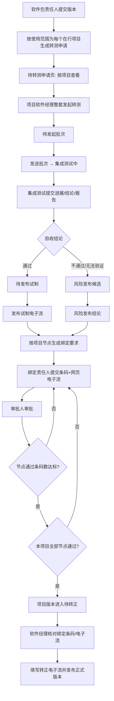
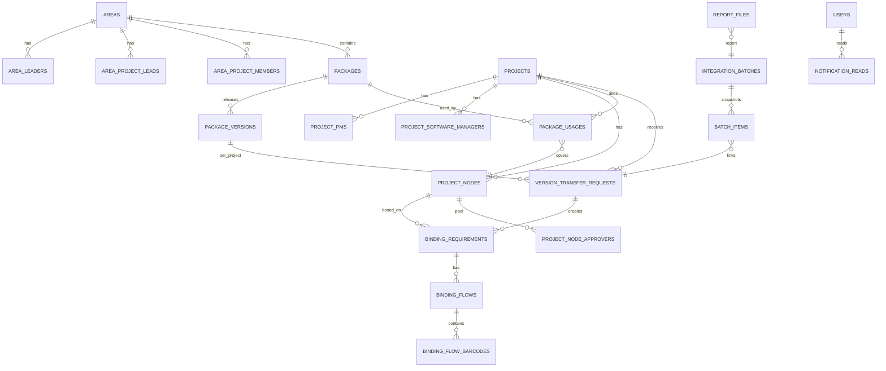

# 工程协同台：业务逻辑与页面联动关系

本文描述系统从“软件包版本提交”到“集成测试、试制绑定、转正发布”的整体业务思路，以及各页面、数据对象和操作之间的联动关系。可用于新人理解系统、产品评审和后续功能扩展。

---

## 1. 一句话理解系统

系统以 **责任田 → 项目 → 项目测试节点 → 软件包版本** 为组织边界：

1. 软件包责任人提交新版本，系统自动把版本分发到该软件包当前使用的全部在行项目；
2. 项目软件经理在待转测申请页组织整套配套批次并送集成测试；
3. 集成测试负责人提交进展、结论和验证报告；
4. 项目软件经理根据验收结论（或无测试批次的风险结论）发布试制；
5. 绑定责任人按项目节点提交设备条码绑定电子流，审批人审批；
6. 全部节点条码数量达标后进入待转正，软件经理核对绑定的真实条码/电子流后发布正式版本。

三个最关键的边界：

- **项目边界**：测试、试制、绑定、转正都以项目为单位独立进行；同一软件包版本可在一个项目已转正、另一个项目仍在测试。
- **版本边界**：所有状态最终落到“项目版本记录”，而不是只落到软件包级别。
- **证据链边界**：试制/转正必须能追溯到集成测试结论、报告、绑定电子流、设备条码和网页电子流地址。

---

## 2. 核心业务主线



风险发布与重新转测的联动：


---

## 3. 角色、责任田与数据范围

### 3.1 系统角色

| 角色 | 主要职责 | 数据范围/限制 |
| --- | --- | --- |
| 系统管理员 | 全部配置、全部流程操作 | 全部项目、责任田、软件包 |
| 软件经理 | 项目转测、测试、试制、作废、转正 | 仅自己被配置为软件经理的项目；不负责软件包基础配置 |
| 集成测试 | 提交项目集成测试结论、报告、进展 | 集成测试责任田的项目负责人只能看本项目；责任田主管可看全部项目 |
| 软件包责任人 | 提交本人软件包的转测申请 | 自己负责的软件包 |
| 绑定验证员 | 提交节点设备条码绑定电子流 | 被配置为绑定责任人的节点，或硬件验证角色 |
| 部门成员 | 查看内部工作台、责任田、项目等 | 按页面权限只读 |
| 评审专家 | 预留角色 | 当前无实际流程入口 |

### 3.2 项目联系人

- 一个项目可以配置 **多位 PM** 和 **多位软件经理**。
- PM 是项目联系人，不自动获得流程操作权限。
- 所有被配置的软件经理都具备该项目的流程权限，项目待办范围取所有软件经理项目的并集。
- 项目联系人数据通过 `project_pms`、`project_software_managers` 维护；旧数据库会从原单 PM/单软件经理字段自动回填。

### 3.3 责任田层级

```text
管理员
  └── 责任田主管（多人）
        └── 项目负责人（每个责任田 + 每个项目）
              └── 项目成员（每个责任田 + 每个项目）
```

- 所有成员可以查看责任田页面。
- 只有管理员可以新建责任田、指定责任田主管。
- 责任田主管可以添加/更换该责任田各项目负责人。
- 项目负责人可以添加本项目在责任田内的成员。
- 软件包配置由责任田主管维护；项目负责人/责任田主管/管理员可以修改软件包责任信息，软件经理不可以修改软件包基础配置。
- 集成测试是独立责任田：其项目负责人负责对应项目的集成测试结论，主管可查看全部项目。

---

## 4. 核心数据对象与关系



### 4.1 关键数据表

| 表 | 含义 | 联动作用 |
| --- | --- | --- |
| `areas` | 责任田 | 决定责任田主管、项目负责人、成员、软件包归属 |
| `projects` | 项目 | 所有版本流程的项目边界 |
| `project_pms` | 项目多 PM | 公开项目联系人、项目视图、项目配置 |
| `project_software_managers` | 项目多软件经理 | 决定流程权限、项目待办范围 |
| `project_nodes` | 项目测试节点 | 转测使用范围、绑定验证节点、绑定责任人与审批人 |
| `project_node_approvers` | 节点审批人范围 | 发试制时复制到绑定要求，提交人从范围内选审批人 |
| `packages` | 软件包 | 责任田/责任人/启停状态/配置权限 |
| `package_versions` | 软件包版本 | 版本号、归档链接、汇总状态、提交人 |
| `package_usages` | 软件包在项目节点的使用范围 | 决定转测分发到哪些项目、批次含哪些包、绑定生成哪些节点 |
| `version_transfer_requests` | 项目版本记录 | 项目维度的核心状态记录；唯一约束 (版本, 项目) |
| `integration_batches` | 项目集成测试批次 | 整套配套、批次状态、结论、报告、时间 |
| `batch_items` | 批次配套快照 | 记录每个包的正式版、试制版、上次转测版、本次版本、是否变更 |
| `binding_requirements` | 项目节点绑定要求 | 发试制后生成，记录所需条码数和审批人快照 |
| `binding_requirement_approvers` | 绑定要求审批人快照 | 发试制时复制节点审批人范围，后续配置变化不影响历史流程 |
| `binding_flows` | 绑定电子流 | 条码、网页电子流地址、提交人、审批人、状态 |
| `binding_flow_barcodes` | 电子流条码明细 | 节点通过数量按审批通过的条码逐个数计算 |
| `report_files` | 验证报告文件 | 通过鉴权接口访问 |
| `notification_reads` | 通知已读记录 | 点击通知后从工作台消失 |
| `audit_logs` | 审计日志 | 记录关键操作 |

### 4.2 重要的唯一/约束关系

- 同一软件包同一版本号全局唯一（忽略大小写）。
- 同一软件包版本在同一项目只有一条项目版本记录。
- 一个批次只能属于一个项目；同一个软件包在批次中只能出现一次。
- 批次号全局唯一，格式 `B` + 至少 3 位数字。
- 同一个项目版本不能被两个 `DRAFT/IN_TEST` 批次同时引用。
- 绑定要求按“项目版本 × 项目节点”生成。
- 同一个绑定要求下，同一设备条码不能在待审批/已通过的电子流中重复出现。

---

## 5. 状态机

### 5.1 项目版本记录状态（version_transfer_requests）

| 状态 | 含义 | 进入方式 |
| --- | --- | --- |
| `PENDING` | 待安排转测 | 提交转测后按项目生成 |
| `IN_TEST` | 集成测试中 | 批次被发送 |
| `PASSED` | 集成测试通过 | 批次结论 PASS |
| `FAILED` | 集成测试不通过 | 批次结论 FAIL |
| `BLOCKED` | 无法完成验证 | 批次结论 BLOCKED |
| `TRIAL` | 试制版本验证中 | 发布试制 |
| `PENDING_FORMAL` | 待转正 | 全部绑定节点通过 |
| `FORMAL` | 正式版本 | 提交转正电子流 |
| `VOID` | 项目试制作废 | 软件经理作废试制 |
| `CANCELLED` | 预留状态 | 当前流程不主动写入；撤回会删除申请，终止批次恢复 `PENDING` |

### 5.2 软件包版本汇总状态（package_versions）

软件包版本有一个由所有项目版本记录汇总出的状态：

| 汇总状态 | 典型含义 |
| --- | --- |
| `PENDING_TRANSFER` | 待转测 |
| `IN_TEST` | 至少一个项目仍在集成测试 |
| `PENDING_TRIAL` | 项目测试结束，待发布试制 |
| `TRIAL` | 至少一个项目试制验证中 |
| `PENDING_FORMAL` | 至少一个项目待转正 |
| `FORMAL` | 全部项目已转正 |
| `VOID` | 版本整体作废/无有效项目流程 |

汇总规则是“取项目记录中最靠前的活动状态”，不是替代项目级状态。页面上真正执行操作时仍以项目版本记录为准。

### 5.3 集成测试批次状态（integration_batches）

```text
DRAFT（待发起）
  → IN_TEST（已发起、测试中）
      → COMPLETED（提交测试结论）
      → TERMINATED（终止测试）
```

- `DRAFT` 可删除、可发起。
- `IN_TEST` 可提交进展、提交结论、终止。
- `COMPLETED/TERMINATED` 进入历史记录，主测试页不再展示为当前批次。

### 5.4 绑定要求/电子流状态

- 绑定要求：`PENDING` → `PASSED`（通过条码数达到要求）。
- 绑定电子流：`PENDING` → `APPROVED` / `REJECTED` / `CANCELLED`。
- 系统在节点通过后会自动取消该节点剩余的待审批电子流；本项目所有节点通过后自动取消剩余待审批电子流并把项目版本置为 `PENDING_FORMAL`。

---

## 6. 页面地图与职责

| 页面/路由 | 主要职责 | 主要用户 | 关键联动 |
| --- | --- | --- | --- |
| `/` | 公开项目联系人 | 所有人（无需登录） | 读取在行项目、多 PM/多软件经理；不暴露内部流程 |
| `/login`、`/register` | 登录/注册 | 所有人 | 登录后进入工作台 |
| `/dashboard` | 个人工作台 | 登录用户 | 派生待办、异常、通知；点击通知标记已读 |
| `/overview` | 部门总览 | 登录用户 | 汇总项目、软件包、在测批次、待试制、待转正、最近活动 |
| `/projects` | 项目视图 | 登录用户 | 在行/存档项目；项目软件包版本；详情抽屉 |
| `/packages` | 软件版本总览 | 登录用户 | 按项目过滤、版本/试制/使用范围；软件包抽屉 |
| `/submissions` | 待转测申请 + 待发起批次 | 责任人/软件经理 | 提交转测、整套批次创建、批次发起/删除、申请撤回 |
| `/integration` | 当前在测批次 | 软件经理/集成测试 | 只显示 IN_TEST；历史批次折叠 |
| `/integration/[id]` | 批次详情 | 软件经理/集成测试 | 配套快照、进展说明、测试结论、报告、终止 |
| `/integration/new` | 旧组织转测入口 | — | 兼容跳转到 `/submissions` |
| `/trial` | 待发布试制 + 绑定验证 | 软件经理/绑定人 | 集成批次联动、风险发布、试制发布、绑定进度 |
| `/trial/[id]` | 绑定验证详情 | 绑定人/审批人/经理 | 节点表格、电子流/条码、审批、撤销、作废 |
| `/formal` | 转正发布 | 软件经理 | 待转正版本；展开显示绑定条码/电子流；提交转正电子流 |
| `/settings/areas` | 责任田配置 | 所有成员可看 | 管理员建责任田；主管维护项目负责人；负责人维护成员 |
| `/settings/projects` | 项目与节点配置 | 管理员/软件经理 | 多 PM/多经理；节点责任人与审批人范围；新增项目仅管理员 |
| `/settings/packages` | 软件包配置 | 管理员/责任田主管 | 软件包基础信息、责任信息、项目节点使用范围 |
| `/settings/packages/[id]` | 软件包配置详情 | 管理员/责任田主管 | 维护使用范围，影响后续批次和绑定覆盖 |
| `/settings/users` | 人员与角色 | 管理员 | 角色调整 |
| `/api/reports/[id]` | 验证报告下载 | 登录用户/鉴权 | 批次详情、试制/转正页面可用 |
| `/api/packages/[id]` | 软件包抽屉详情 | 登录用户 | 软件包总览按需打开 |
| `/api/notifications/read` | 通知已读跳转 | 登录用户 | 记录已读并 303 跳转到目标详情 |

---

## 7. 主要场景的联动关系

### 场景一：维护项目、责任田、软件包使用范围

联动链：

```text
新建/编辑项目
  → 配置多 PM、多软件经理
  → 决定公开项目联系人、项目视图联系人
  → 决定软件经理流程权限和待办范围

配置项目节点
  → 决定转测批次中该项目的测试节点
  → 决定发试制时为哪些节点生成绑定要求
  → 节点审批人范围会复制到绑定要求

配置软件包
  → 设置责任田、责任人、启停状态
  → 配置 package_usages（项目 + 节点）
  → 决定后续转测分发到哪些项目、批次包含哪些包、绑定生成哪些节点
```

影响页面：

- `/settings/projects`、`/settings/packages`、`/settings/packages/[id]`
- `/` 公开首页
- `/projects` 项目视图
- `/packages` 使用范围
- `/submissions`、`/integration/new` 的候选包和候选节点
- `/trial` 的绑定任务

注意：

- 已归档项目不参与新的转测/绑定，但在项目视图存档项目里保留软件包使用记录。
- 软件包停用后在转测、批次、绑定页面不再作为新流程候选。
- 节点删除前必须无软件包使用、无绑定历史。

### 场景二：提交转测申请

入口：`/submissions` → “提交转测申请”弹窗。

四项必填：

1. 软件包（支持搜索）
2. 版本号
3. 修复问题/完成需求
4. 包归档链接

提交时联动：

```text
提交转测
  → 创建 package_versions（状态 PENDING_TRANSFER）
  → 查询 package_usages 中所有使用该软件包的在行项目
  → 为每个项目创建 version_transfer_requests（状态 PENDING）
  → 待转测申请页按项目分组显示
  → 项目软件经理待办出现“待组织转测”
  → 软件包总览/项目视图出现该版本记录
```

边界逻辑：

- 软件包必须已启用且至少关联一个在行项目节点。
- 同一软件包同一版本号不能重复提交。
- 申请提交后，软件经理只看到自己项目的申请。
- 申请只有在所有项目记录均为 `PENDING` 且未被批次引用时才能整份撤回；撤回会删除版本和全部项目申请。
- 如果申请已被 `DRAFT/IN_TEST` 批次引用，不能撤回，必须先处理批次。

### 场景三：创建整套配套批次

入口：`/submissions` → 项目分组 → “整套发起转测”弹窗。

联动计算：

```text
选择项目和版本
  → 校验批次号全局唯一
  → 拉取该项目全部启用中的在用软件包
  → 必须为每个软件包选择一个版本（不能重复、不能漏包）
  → 每个包计算：
       当前正式版本
       当前试制版本
       上次本项目转测版本
       本次选择版本
       是否与上次不同
  → 至少一个包关联 PENDING 转测申请，否则不能创建批次
  → 创建 integration_batches（DRAFT）
  → 创建 batch_items 快照
```

版本默认规则：

1. 有本项目待转测申请 → 默认该新版本；
2. 否则优先沿用上次本项目转测版本；
3. 再否则使用本项目正式版本；
4. 否则使用第一个非作废版本；
5. 已作废版本显示“本项目已作废”并警告，默认避开。

创建后联动：

- 批次出现在 `/submissions` 的“待发起转测批次”；
- 不进入集成测试页；
- 不改变项目版本状态；
- 软件包版本不改变；
- 可从待转测申请页发起或删除。

### 场景四：发送批次 → 集成测试

操作：`/submissions` 待发起批次 → “发起转测”。

联动：

```text
integration_batches: DRAFT → IN_TEST
  → 批次内所有关联的转测申请: PENDING → IN_TEST
  → 刷新软件包版本汇总状态
  → 集成测试页出现当前在测批次
  → 集成测试责任田项目负责人工作台出现“待提交结论”
  → 项目软件经理工作台出现“跟踪测试进度”
```

发送前校验：

- 只能是 DRAFT；
- 操作人必须是该项目软件经理（或管理员）；
- 批次中至少一个变更包；
- 关联申请必须仍为 PENDING，不能已被其他批次占用。

### 场景五：集成测试进展、结论、报告

入口：`/integration/[id]`。

#### 进展说明

- 集成测试负责人可随时提交进展；
- 写入 `batch_progress_notes`；
- 批次详情显示时间线；
- 不改变项目版本状态。

#### 提交结论 + 报告

必填：结论（PASS/FAIL/BLOCKED）、问题归属、测试总结、验证报告文件。

联动：

```text
提交结论
  → 保存报告 report_files + 批次报告信息
  → integration_batches: IN_TEST → COMPLETED
  → 批次内项目版本：
       PASS → PASSED
       FAIL → FAILED
       BLOCKED → BLOCKED
  → 刷新 package_versions 汇总状态 → PENDING_TRIAL
  → 项目软件经理待发布试制队列出现该版本
  → 提交该软件包的申请人工作台出现：
       测试通过：不产生异常提醒
       不通过/无法验证：产生异常提醒
```

验收结论的影响：

- `PASS`：可以正常发布试制。
- `FAIL/BLOCKED`：仍在待发布试制队列中，但标记风险；发布试制时必须填写风险结论。
- 批次报告和测试总结可在待发布试制页点回批次查看，也可在转正/绑定详情查看关联证据。

#### 终止批次

```text
IN_TEST → TERMINATED
  → 批次内所有关联项目版本恢复 PENDING
  → 刷新软件包汇总状态
  → 批次移入历史记录
  → 等待尚未结束的测试或其他批次重新处理
```

### 场景六：待发布试制与风险发布

入口：`/trial`（有集成测试 / 项目软件经理权限的用户）。

待发布试制队列由两类版本组成：

#### A. 集成测试已结束的版本

- 显示关联批次（如 `B122`）、验收结论、测试总结、验证报告；
- 点击批次可回到 `/integration/[id]` 查看完整测试详情；
- 点击验证报告走鉴权文件接口；
- 结论为 PASS 时按正常发布流程；
- 结论为 FAIL/BLOCKED 时标为风险发布，发布时必须填写风险结论。

#### B. 未关联批次的风险发布版本

- 显示“风险发布”标识；
- 显示风险结论；
- 如果后续重新转测并产生最新批次，页面按最新关联批次展示联动。

发布试制联动：

```text
点击发布试制
  → 校验项目软件经理权限
  → 校验项目版本状态允许发布
  → 判断是否需要风险发布：
       非 PASSED 或 无关联批次
       → 风险结论必填
  → 请求状态 → TRIAL
  → 记录发布试制电子流、发布时间、发布人、风险结论/release_mode
  → 按 package_usages 为本项目节点创建 binding_requirements
  → 复制 project_node_approvers → binding_requirement_approvers
  → 刷新软件包汇总状态
  → /trial 的绑定验证表格出现新版本
  → 绑定责任人工作台出现待绑定任务
```

校验：

- 必须配置项目节点，且每个节点有绑定责任人、主审批人。
- 无绑定责任人/审批人时不能发布。
- 绑定任务只覆盖本项目使用节点，不会扩展到其他项目。

### 场景七：绑定验证与条码数据联动

入口：`/trial/[id]`。

页面数据来源：

```text
项目版本 → binding_requirements（每个项目节点一条）
       → binding_requirement_approvers（审批人范围快照）
       → binding_flows（电子流）
       → binding_flow_barcodes（条码明细）
```

#### 提交绑定电子流

必填：

- 从审批人范围选择审批人；
- 设备条码（多行，可批量粘贴/扫码）；
- 网页电子流地址。

规则：

- 只有本项目该节点的绑定责任人、验证员角色或管理员可提交；
- 审批人不能是提交人；
- 审批人必须在该节点审批人范围内；
- 条码 3–80 字符；
- 同一节点下，待审批/已通过电子流中不能重复提交同一条码；
- 同一节点可多次提交电子流；
- 一个电子流可包含几十个条码；
- 页面按“条码 N 个”显示，展开查看明细，避免撑长页面。

审批联动：

```text
提交电子流 PENDING
  → 审批人工作台出现待审批
  → 审批通过后统计该要求下所有 APPROVED 电子流条码
  → 通过条码数 >= required_count
      → binding_requirements: PASSED
      → 自动取消该节点剩余 PENDING 电子流
  → 本项目全部 requirements PASSED
      → 项目版本: TRIAL → PENDING_FORMAL
      → 自动取消本项目剩余 PENDING 电子流
      → 项目软件经理工作台出现“待转正”
      → 软件包汇总状态更新
```

驳回/撤销：

- 驳回：电子流 `REJECTED`，产生提交人通知，不影响节点已通过条码数。
- 提交人可撤销自己的待审批电子流；软件经理/管理员也可撤销。
- 节点通过后系统自动取消的多余电子流记录为 `CANCELLED`。

作废试制联动：

```text
项目软件经理作废试制（原因至少 5 字）
  → 项目版本 status = VOID
  → 刷新软件包汇总状态
  → 该版本下所有待审批电子流不会自动删除
  → 提交人工作台出现“试制版本已作废，请撤销电子流”
  → 提交人进入绑定详情撤销电子流
  → 审批人不能再审批（版本非 TRIAL）
```

### 场景八：转正发布与绑定条码证据联动

入口：`/formal`。

页面展示来源：

```text
待转正项目版本
  → 项目版本记录 PENDING_FORMAL
  → 读取 version_transfer_requests / package_versions
  → 通过 getTrialDetail 读取绑定要求、电子流、条码、网页电子流
  → 显示节点通过情况、实际通过条码、电子流编号、网页地址
```

联动细节：

- 转正页面不再只显示“节点通过”，而是展开“实际绑定条码与电子流”；
- 每个节点显示通过条码数；
- 每个已通过电子流显示条码清单和网页电子流链接；
- 可进入 `/trial/[id]` 查看更完整的绑定过程；
- 可查看发布试制电子流、归档地址、变更说明、集成批次/验收结论（如存在）。

发布转正：

```text
校验：项目版本 PENDING_FORMAL
  → 校验全部 binding_requirements PASSED
  → 填写“转正电子流”
  → 项目版本 status = FORMAL
  → 记录转正发布时间/发布人/电子流
  → 刷新 package_versions 汇总状态
  → 版本从待转正/待试制队列消失
  → 软件包总览/项目视图显示正式版本
  → 如果该软件包全部项目都已转正，汇总状态为 FORMAL
```

### 场景九：项目视图、软件包总览与公开联系人

#### 公开首页

```text
项目 + project_pms + project_software_managers
  → 只展示在行项目
  → 支持按项目/PM/软件经理搜索
  → 不展示内部版本、测试、绑定、审批数据
```

#### 项目视图

- `/projects?group=active|archived&project=<id>`
- 选择项目由服务端 URL 驱动，不依赖客户端状态。
- 展示项目 PM/软件经理、节点、软件包使用范围和版本状态。
- 存档项目只用于历史查看，不参与新流程。

#### 软件包总览

- `/packages?project=<id>&open=<packageId>`
- 展示正式版本、当前试制版本、在途版本、使用范围；
- 使用范围不展示已归档项目；
- 详情抽屉由服务端预加载；
- 点击后打开，避免客户端二次请求空白。

### 场景十：个人工作台与通知

个人工作台不是独立业务数据，而是从各业务表即时派生：

- 作为软件包提交人：测试异常提醒；
- 作为绑定责任人：待绑定节点；
- 作为绑定审批人：待审批电子流；
- 作为软件经理：待组织转测、在测批次跟踪、待发布试制、待转正；
- 作为集成测试负责人：待提交结论批次；
- 绑定结果通知、试制作废提醒；
- 已读记录 `notification_reads` 过滤掉点击过的告警/通知；
- 点击通知通过 `/api/notifications/read` 记录已读，再 303 跳转到目标详情。

---

## 8. 操作 → 数据变化 → 页面联动速查表

| 操作 | 直接数据变化 | 立即受影响的页面/工作台 |
| --- | --- | --- |
| 新增/编辑项目 | projects、project_pms、project_software_managers | 公开首页、项目视图、项目配置、经理待办范围 |
| 配置节点 | project_nodes、project_node_approvers | 项目配置、发试制后的绑定任务、审批人范围 |
| 新增/编辑软件包 | packages、package_usages | 软件包配置/总览、转测候选、批次候选、绑定覆盖 |
| 提交转测 | package_versions、version_transfer_requests | 待转测申请、软件包总览、项目视图、经理待办 |
| 撤回转测 | 删除版本和项目申请（仅 PENDING 且未被批次引用） | 待转测申请、软件包总览、项目视图、工作台 |
| 创建整套批次 | integration_batches(DRAFT)、batch_items | 待转测申请页待发起批次；集成测试页不可见 |
| 发起批次 | 批次 IN_TEST、申请 IN_TEST、版本汇总更新 | 集成测试页、集成测试负责人待办、经理待办 |
| 提交进展 | batch_progress_notes | 批次详情时间线 |
| 提交测试结论 | 批次 COMPLETED、申请 PASSED/FAILED/BLOCKED、报告、版本汇总 | 待发布试制、工作台异常、批次历史、项目视图 |
| 终止批次 | 批次 TERMINATED、申请恢复 PENDING、版本汇总 | 集成测试历史、待转测申请/经理待办 |
| 发布试制 | 申请 TRIAL、release_mode/risk_conclusion、binding_requirements、审批人快照 | 绑定验证页、绑定人待办、工作台 |
| 提交绑定电子流 | binding_flows、binding_flow_barcodes | 绑定详情、审批人待办、提交人“我的绑定电子流” |
| 审批通过/驳回 | flow APPROVED/REJECTED、节点/项目状态可能推进 | 绑定详情、绑定人待办、通知、转正队列 |
| 撤销电子流 | flow CANCELLED | 绑定详情、审批人待办消失 |
| 作废试制 | 申请 VOID、版本汇总 | 绑定详情、绑定人提醒、试制页 |
| 发布转正 | 申请 FORMAL、正式版本时间/电子流、版本汇总 | 转正页、待发布/绑定页、软件包总览、项目视图 |
| 读通知 | notification_reads | 个人工作台告警/通知消失 |

---

## 9. 关键边界与异常逻辑

### 9.1 项目维度

- 同一软件包版本可在不同项目处于不同状态；所有流程操作都以“项目版本”为单位。
- 一个项目只能看到和管理自己的待转测、批次、试制、绑定、转正。
- 项目可有多位 PM/软件经理，每位经理都拥有本项目流程权限。

### 9.2 批次维度

- 批次必须覆盖该项目全部启用的在用软件包，不允许只选部分包。
- 允许同一项目并行多个批次，但同一个项目版本不能同时被两个进行中的批次引用。
- 批次默认版本优先沿用上次本项目转测版本；只有存在本项目待转测申请的包默认使用新版本。
- 一个批次至少包含一个关联 PENDING 申请的“变更包”才能创建。
- 批次号全局唯一，不按项目重置。
- 终止批次会把关联项目版本恢复为 PENDING，不会自动把版本作废。

### 9.3 风险发布维度

- 待发布试制队列既包含集成测试结束版本，也包含风险发布版本。
- 关联批次的版本显示批次、验收结论、报告，可点击回到批次。
- 没有批次或非 PASS 的版本标记风险发布；发布试制时必须填写/确认风险结论。
- 后续有关联批次时，按最新批次进行展示联动。
- 风险发布不阻止绑定和转正；但它会保留风险标识和结论，作为转正证据链的一部分。

### 9.4 绑定维度

- 绑定任务在发试制时生成，只有项目版本处于 TRIAL 时可操作。
- 绑定通过数量按审批通过的设备条码数量计算，不按电子流条数。
- 同一节点可多次提交电子流；节点通过后系统自动关闭剩余待审批电子流。
- 审批人范围在发试制时快照到要求上；后续节点配置变化不改变历史要求。
- 审批人不能审批自己提交的电子流。
- 提交人可撤销自己待审批的电子流；软件经理/管理员可代撤销。
- 试制作废后不会自动删除待审批电子流，提交人会收到撤销提醒；版本已非 TRIAL，审批人无法继续审批。
- 绑定验证全部节点通过后，项目版本自动进入 PENDING_FORMAL，剩余电子流自动取消。

### 9.5 转正维度

- 只有 PENDING_FORMAL 且全部绑定要求 PASSED 的版本可以转正。
- 转正页联动展示绑定条码、电子流编号、网页电子流地址、转测批次/验收结论（如有）；无批次版本显示风险发布标识。
- 转正后项目版本 FORMAL；软件包汇总状态按所有项目计算。
- 同一版本在 A 项目已正式，不阻止 B 项目继续试制/转正。

### 9.6 项目/软件包配置维度

- 项目新增仅管理员；项目配置页对管理员和软件经理开放，软件经理可编辑已有项目。
- 软件包配置仅责任田主管/管理员；软件经理不能进入软件包配置页，软件包抽屉中也不能编辑责任信息。
- 使用范围变更影响之后的新转测、新批次和新发试制的绑定覆盖，不会回写历史批次/历史绑定要求。
- 归档项目保留历史记录，但从新转测、公开联系人、软件包使用范围中移除。

### 9.7 通知/已读维度

- 工作台告警与通知都是派生数据，不是独立消息表。
- 点击通知先写 `notification_reads`，再跳转到对应业务详情。
- 同一通知 key 对同一用户只记录一次已读；已读后统计数字同步减少。

---

## 10. 典型端到端示例

### 示例 A：1001OTA 1.6.0 在 N1 的完整链路

```text
提交 1.6.0
  → 生成 N1/M2 等项目版本记录 PENDING
  → MGR001 在 /submissions 创建整套批次（含 OTA 1.6.0）
  → 发送后 N1 批次 B119 IN_TEST、OTA N1 申请 IN_TEST
  → TEST001 提交 PASS + 报告
  → 批次 COMPLETED、OTA N1 申请 PASSED
  → /trial 待发布试制显示：关联批次 B119、结论测试通过、验证报告
  → MGR001 发布试制，填写试制电子流
  → 本节点生成 EVT/DVT/PVT 绑定要求
  → VALID001 提交条码+网页电子流 → OWNER001/经理审批
  → 全部节点通过 → OTA N1 PENDING_FORMAL
  → /formal 展开看到每个节点的通过条码和电子流
  → MGR001 填写转正电子流并发布 → OTA N1 FORMAL
```

### 示例 B：1004NET 2.0.0 在 M2 的风险发布

```text
NET 2.0.0 的 M2 项目版本没有关联集成测试批次
  → /trial 待发布试制显示“风险发布”和风险结论
  → MGR002 发布试制时必须确认风险结论
  → 生成 M2 节点绑定要求
  → 绑定/审批/转正流程继续走正常链路
```

### 示例 C：1006KEY 1.3.0 N1 试制绑定

```text
KEY 1.3.0 N1 已发布试制（种子数据为风险发布）
  → /trial 绑定验证表格显示 EVT 通过、PVT 待绑定
  → EVT 有已通过电子流和条码；PVT 有待审批/被驳回电子流
  → 绑定责任人可提交新电子流；审批人可审批；提交人可撤销
  → 如果作废试制：申请 VOID，提交人收到撤销提醒
```

---

## 11. 代码入口速查

| 逻辑 | 主要文件 |
| --- | --- |
| 表结构/迁移 | `lib/schema.ts`、`lib/db.ts` |
| 演示数据 | `lib/seed.ts` |
| 权限与项目/责任田范围 | `lib/access.ts`、`lib/permissions.ts` |
| 转测、批次、试制、绑定、转正服务 | `lib/workflow.ts` |
| 工作台、批次、试制、转正查询 | `lib/workflow-queries.ts` |
| 项目/软件包/总览查询 | `lib/queries.ts` |
| Server Actions | `lib/actions/workflow.ts`、`lib/actions/settings.ts` |
| 项目/节点/软件包配置 | `lib/settings.ts` |
| 页面 | `app/(workspace)/*` |
| 端到端测试 | `tests/e2e/workflow.spec.ts`、`tests/e2e/public-auth.spec.ts` |

---

## 12. 总结

系统的联动核心可以概括为一条链：

```text
使用范围（package_usages）
  → 决定转测申请分发和批次包含的软件包
  → 决定发试制时为哪些项目节点生成绑定要求
  → 绑定条码审批数量
  → 决定项目版本是否可转正
  → 转正页回显集成结论与绑定证据
```

页面不是各自独立维护状态，而是围绕 **项目版本记录** 这个中心对象，分别读写：

- 转测申请页：项目版本从 PENDING 到 IN_TEST；
- 集成测试页：批次和项目版本的测试结论；
- 试制页：项目版本 TRIAL、风险结论和绑定要求；
- 绑定详情：条码/电子流/审批结果；
- 转正页：项目版本 PENDING_FORMAL → FORMAL，并回显完整的验收和绑定证据；
- 软件包总览/项目视图/工作台：分别从项目版本、汇总版本、待办派生数据展示当前状态。
