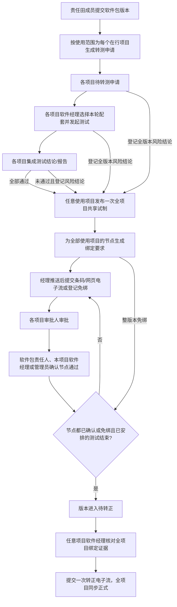
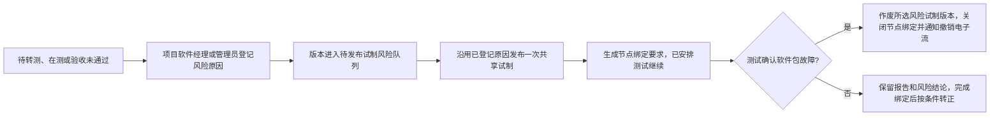
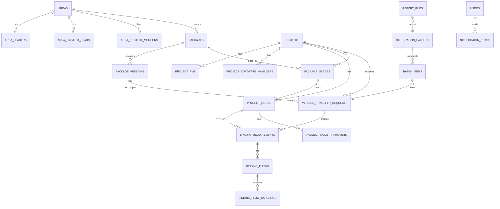

# 工程协同台：业务逻辑与页面联动关系

本文描述系统从“软件包版本提交”到“集成测试、试制绑定、转正发布”的整体业务思路，以及各页面、数据对象和操作之间的联动关系。可用于新人理解系统、产品评审和后续功能扩展。

---

## 1. 一句话理解系统

系统以 **责任田 → 项目 → 项目测试节点 → 软件包版本** 为组织边界：

1. 责任田主管、项目负责人和成员可以提交所属责任田的启用软件包。提交后，版本分发到该包当前使用的全部在行项目。
2. 项目软件经理选择本轮配套，确认待发起批次快照后送集成测试。暂缓的软件包可在下一轮选择。
3. 各项目提交自己的测试进展、结论和报告。验收尚未完成或存在其他风险时，软件经理可记录理由并发布**一次**全项目共享试制。
4. 试制后由软件经理决定是否推送绑定。节点责任人可提交条码、网页电子流，或说明该节点无需绑定。
5. 节点达标或免绑、已安排的测试结束且待审批电子流已全部处理后，任意使用项目的软件经理或管理员可发布**一次**共享转正。风险试制中的版本被测试定位为问题来源时，跨项目作废并关闭节点绑定。

三个最关键的边界：

- **项目边界**：登录用户可浏览所有项目的基础资料。转测申请、集成测试批次及项目流程的读取和操作按项目与角色校验。
- **版本发布边界**：试制与转正是软件包版本级共享动作；同一个版本只发一次试制、一次转正，所有使用项目同步生效。
- **证据链边界**：新发布的试制和转正均要求填写 HTTP(S) 电子流网址和文字评审纪要。试制与转正纪要分别按共享软件包版本保存，版本全链路可查。既有电子流编号、报告和其他证据保留。发布必须能追溯到所有项目的集成测试结论、报告、绑定电子流、设备条码和网页电子流地址；任何版本都可进入“版本全链路”页面回看。

---

## 2. 核心业务主线



风险发布与重新转测的联动：



注意：试制/转正按软件包版本共享，不再由各项目分别发布。

### 办理条件与交接

有权办理的用户在记录详情可以打开下一步的办理条件。条件不齐时，页面列出可见的项目、批次、节点或电子流，并提供对应处理入口。有权查看、需由其他角色办理时，页面指出负责角色。跨项目详情和链接继续按项目数据范围校验。

- 普通试制按当前使用范围检查各在行项目的验收。已登记的风险试制按风险队列检查。发布还要核对试制所需的节点配置。
- 转正核对已发布试制所覆盖的在行项目。各节点确认通过或登记免绑、已安排的测试结束后，版本进入待转正。发布前还需处理待审批的绑定电子流。超期用于催办。
- 工作台按去重条码给出绑定待办。已登记的通过和待审批条码合计达标时，绑定责任人可直接跟进待审批电子流。仅审批通过的条码计入节点通过门槛。
- 条件弹窗使用当前数据，写操作在服务端重新校验。操作状态变化后，返回原列表或版本详情查看下一步。

---

## 3. 角色、责任田与数据范围

### 3.1 系统角色

| 角色 | 主要职责 | 数据范围/限制 |
| --- | --- | --- |
| 系统管理员 | 维护账号、责任田、项目及软件经理指派 | 全部项目、责任田、软件包，操作须满足业务条件 |
| 普通账号 | 按具体分工处理业务 | 基础项目资料可见，内部流程按项目或具体对象授权 |

### 3.1.1 页面数据范围

- 项目总览向登录用户展示全部项目的名称、代号、产品阶段、PM 和软件经理，包含已归档项目。
- 项目工作区单独校验流程权限。管理员可查阅全部，软件经理和集成测试负责人在各自负责的范围内查阅。软件包、节点和审批分工按对应对象开放。兼任人员按实际分工的范围读取业务记录。
- 只具备基础信息查看权限的用户可打开项目资料和权限提示。直接访问带项目范围的流程列表和详情仍由各路由校验。
- 待转测申请的版本追溯按申请所在项目判断工作区权限。有该项目工作区权限时保留项目范围，仅获授权查看软件包或申请时进入按版本权限筛选的全链路页面。
- 已绑定到批次的验证报告按批次的阅读权限返回。共享发布的跨项目核对和各项目的业务写入沿用对应流程权限。

### 3.2 项目联系人

- 一个项目可以配置 **多位 PM** 和 **多位软件经理**。
- 管理员从启用账号中指派软件经理。被指派的软件经理可维护自己项目的 PM、项目资料和节点。
- PM 是项目联系人，不自动获得流程操作权限。
- 所有被配置的软件经理都具备该项目的流程权限，项目待办范围取所有软件经理项目的并集。
- 项目联系人保存在 `project_pms`、`project_software_managers`。旧库保留原人员 ID、联系人指派、分工和历史证据。必要时从已有单 PM、单软件经理字段补齐关系，非管理员账号统一为普通账号。

### 3.3 责任田层级

```text
管理员
  └── 责任田主管（多人）
        └── 项目负责人（每个责任田 + 每个项目）
              └── 项目成员（每个责任田 + 每个项目）
```

- 所有成员可以查看责任田页面。
- 只有管理员可以新建责任田、指定责任田主管。
- 责任田主管可以添加/更换该责任田各项目负责人。
- 项目负责人可以添加本项目在责任田内的成员。
- 软件包配置由责任田主管或管理员维护。责任田项目负责人可以修改分工范围内的软件包责任信息。
- 集成测试是独立责任田：其项目负责人负责对应项目的集成测试结论，主管可查看全部项目。

---

## 4. 核心数据对象与关系



### 4.1 关键数据表

| 表 | 含义 | 联动作用 |
| --- | --- | --- |
| `areas` | 责任田 | 决定责任田主管、项目负责人、成员、软件包归属 |
| `projects` | 项目 | 记录产品阶段 `stage` 与流程状态 `status`，提供版本流程的项目边界 |
| `project_pms` | 项目多 PM | 公开项目联系人、项目总览、项目工作区、项目配置 |
| `project_software_managers` | 项目多软件经理 | 决定流程权限、项目待办范围 |
| `project_nodes` | 项目测试节点 | 转测使用范围、绑定验证节点、绑定责任人与审批人 |
| `project_node_approvers` | 节点审批人范围 | 发试制时复制到绑定要求，提交人从范围内选审批人 |
| `packages` | 软件包 | 责任田/责任人/启停状态/说明/试制超期天数/配置权限 |
| `package_versions` | 软件包版本 | 版本号、归档链接、汇总状态、提交人 |
| `package_usages` | 软件包在项目节点的使用范围 | 决定转测分发到哪些项目、批次含哪些包、绑定生成哪些节点 |
| `version_transfer_requests` | 项目版本记录 | 项目维度的核心状态记录；唯一约束 (版本, 项目) |
| `integration_batches` | 项目集成测试批次 | 整套配套、批次状态、结论、报告、时间 |
| `batch_items` | 批次配套快照 | 记录每个包的正式版、试制版、上次转测版、本次版本、是否变更 |
| `binding_requirements` | 项目节点绑定要求 | 发试制后生成，记录所需条码数和审批人快照 |
| `binding_requirement_approvers` | 绑定要求审批人快照 | 发试制时复制节点审批人范围，后续配置变化不影响历史流程 |
| `binding_flows` | 绑定电子流 | 条码、网页电子流地址、提交人、指定审批人、实际审批人、状态 |
| `binding_flow_barcodes` | 电子流条码明细 | 节点按去重后的已审批条码检查最低数量 |
| `report_files` | 验证报告文件 | 通过鉴权接口访问 |
| `notification_reads` | 通知已读记录 | 点击通知后从工作台消失 |
| `audit_logs` | 审计日志 | 记录关键操作 |

### 4.2 重要的唯一/约束关系

- 常用流程列表默认显示软件包编码。软件包名称可在详情、配置和核对操作对象时查阅。通用搜索可按两者查找，独立的编码和名称筛选各自匹配对应的显示值，按软件包排序使用编码。旧数据中对调存储的编码和名称在读取时统一转换，版本及配套关系仍按软件包 ID 关联。
- 同一软件包同一版本号全局唯一（忽略大小写）。
- 同一软件包版本在同一项目只有一条项目版本记录。
- 一个批次只能属于一个项目；同一个软件包在批次中只能出现一次。
- 批次号全局唯一，格式 `B` + 至少 3 位数字。
- 同一个项目版本不能被两个 `DRAFT/IN_TEST` 批次同时引用。
- 绑定要求按“项目版本 × 项目节点”生成。
- 同一个绑定要求下，同一设备条码不能在待审批/已通过的电子流中重复出现。

---

## 5. 状态机

### 5.1 项目版本记录状态（version_transfer_requests）

| 状态 | 含义 | 进入方式 |
| --- | --- | --- |
| `PENDING` | 待安排转测 | 提交转测后按项目生成 |
| `IN_TEST` | 集成测试中 | 批次被发送 |
| `PASSED` | 集成测试通过 | 批次结论 PASS |
| `FAILED` | 集成测试不通过 | 批次结论 FAIL |
| `BLOCKED` | 无法完成验证 | 批次结论 BLOCKED |
| `TRIAL` | 试制版本验证中 | 发布试制 |
| `PENDING_FORMAL` | 待转正 | 节点确认通过或免绑，且已安排的测试结束 |
| `FORMAL` | 正式版本 | 提交转正电子流 |
| `VOID` | 版本放弃/作废 | 放弃发布试制、试制/待转正/正式版本作废 |
| `CANCELLED` | 预留状态 | 当前流程不主动写入；撤回会删除申请，终止批次恢复 `PENDING` |

风险试制期间，`status` 表示试制生命周期，`integration_status` 单独记录测试进展。测试结束时同步保留项目验收结论及报告。

### 5.2 软件包版本汇总状态（package_versions）

软件包版本有一个由所有项目版本记录汇总出的状态：

| 汇总状态 | 典型含义 |
| --- | --- |
| `PENDING_TRANSFER` | 待转测 |
| `IN_TEST` | 至少一个项目仍在集成测试 |
| `PENDING_TRIAL` | 全部使用项目测试结束，待发布共享试制 |
| `TRIAL` | 共享试制验证中，全部使用项目均处于该试制版本 |
| `PENDING_FORMAL` | 节点达标或免绑且已安排的测试结束，待共享转正 |
| `FORMAL` | 全部使用项目已同步转正 |
| `VOID` | 版本整体作废/无有效项目流程 |

汇总规则是“取项目记录中最靠前的活动状态”。共享试制/转正会一次性同步全部使用项目版本，因此软件包版本状态与项目版本状态在试制/转正阶段保持一致。

### 5.3 集成测试批次状态（integration_batches）

```text
DRAFT（待发起）
  → IN_TEST（已发起、测试中）
      → COMPLETED（提交测试结论）
      → TERMINATED（终止测试）
```

- `DRAFT` 可删除、可发起。
- `IN_TEST` 可提交进展、提交结论、终止。
- `COMPLETED/TERMINATED` 进入历史记录，主测试页不再展示为当前批次。

### 5.4 绑定要求/电子流状态

- 节点有效条码数达到最低要求时，绑定要求从 `PENDING` 进入 `PASSED`。撤销已通过的电子流后降到门槛以下时回到 `PENDING`。
- 绑定电子流从 `PENDING` 进入 `APPROVED`、`REJECTED` 或 `CANCELLED`。正式发布前，可登记撤销已通过的电子流。
- 达标后已有的待审批电子流继续处理，节点仍可追加电子流。发布正式版前须处理全部待审批电子流。

---

## 6. 页面地图与职责

| 页面/路由 | 主要职责 | 主要用户 | 关键联动 |
| --- | --- | --- | --- |
| `/` | 公开项目联系人 | 所有人（无需登录） | 读取在行项目、多 PM/多软件经理；不暴露内部流程 |
| `/login`、`/register` | 登录/注册 | 所有人 | 从内部链接发起登录后回到原页面，直接登录或注册进入工作台 |
| `/account/password` | 修改密码 | 登录用户，仅本人 | 验证当前密码，保存新密码后撤销该账号的全部会话并返回登录页 |
| `/dashboard` | 个人工作台 | 登录用户 | 派生待办、异常、通知；点击通知标记已读 |
| `/overview` | 项目总览 | 登录用户 | 列出全部项目的基础资料，支持关键词、逐列筛选和分页 |
| `/projects` | 原项目目录地址 | 登录用户 | 兼容跳转到 `/overview`，保留适用的筛选与分页参数 |
| `/projects/[id]` | 项目概览 | 登录用户 | 显示项目资料。获授权后显示流程待办、超期、近期批次、版本和软件包使用范围 |
| `/packages` | 软件版本总览 | 登录用户 | 支持按项目和表头筛选，使用范围列显示全部在行项目。详情的版本历史和使用范围支持搜索与分页 |
| `/versions`、`/versions/[id]` | 版本全链路 | 登录用户，按项目访问权限读取 | 搜索版本，查看转测、验收、报告、试制风险、绑定及转正证据 |
| `/submissions` | 待转测申请与待发起批次 | 登录用户，按项目、责任田和角色检查操作权限 | 申请逐列筛选，保留筛选隐藏的勾选项并提示数量，创建批次前可核对完整配套 |
| `/submissions/transfer` | 提交转测申请 | 所属责任田的主管、项目负责人、成员及管理员 | 搜索可提交的软件包，从软件包详情进入时可预选该包 |
| `/submissions/batch/new?project=<id>` | 准备转测批次 | 当前项目软件经理或管理员 | 选定本轮配套和版本后保存草稿，进入批次详情核对快照 |
| `/integration` | 在测与历史批次 | 软件经理和集成测试 | 默认显示正在测试的批次；历史按可见项目范围在服务端逐列筛选后分页 |
| `/integration/[id]` | 批次详情 | 软件经理/集成测试 | 配套快照、进展说明、测试结论、报告、终止 |
| `/integration/[id]/compare` | 批次对比 | 按两边批次的读取权限校验 | 对比同项目两批软件包配套，返回时保留原列表条件 |
| `/integration/new` | 旧组织转测入口 | — | 兼容跳转到 `/submissions` |
| `/trial` | 试制发布与绑定验证 | 软件经理和绑定人 | 分开显示按版本聚合的发布队列与按项目区分的绑定队列，各自支持表头筛选及详情返回 |
| `/trial/[id]` | 绑定验证详情 | 绑定人/审批人/经理/管理员 | 节点表格、电子流和条码、追加、审批、撤销、推送绑定、免绑、作废、超期 |
| `/formal`、`/formal/[id]` | 转正发布列表与详情 | 软件经理 | 从列表选择版本，在详情核对全项目验收和绑定证据，确认发布后打开已发布版本全链路 |
| `/settings/areas`、`/settings/areas/[id]` | 责任田目录与详情 | 所有成员可看 | 目录支持逐列筛选、排序与分页，详情支持查找与分页项目。管理员设置主管，主管设置项目负责人，负责人在弹窗搜索并添加项目成员 |
| `/settings/projects`、`/settings/projects/[id]` | 项目配置目录与详情 | 管理员和项目软件经理 | 从目录打开单个项目，维护产品阶段、流程状态和联系人，搜索测试节点 |
| `/settings/projects/[id]/nodes/[nodeId]` | 单节点配置 | 管理员和本项目软件经理 | 独立配置当前节点的责任人、主审批人、审批人范围和通过数量 |
| `/settings/packages` | 软件包配置 | 管理员/责任田主管 | 逐列筛选、分页和配置软件包基础信息、责任信息、项目节点使用范围 |
| `/settings/packages/[id]` | 软件包配置详情 | 管理员/责任田主管 | 维护基础信息、试制超期天数、使用范围 |
| `/settings/packages/import` | 导入历史版本 | 管理员/责任田主管 | 补录系统启用前已有转正/试制版本；不创建流程待办 |
| `/settings/users`、`/settings/users/[id]` | 人员目录与详情 | 管理员 | 逐列筛选和分页，在单人详情调整权限和启停状态 |
| `/api/reports/[id]` | 验证报告下载 | 对应批次的授权用户 | 批次详情、试制/转正页面可用。新报告按项目和批次存放，历史文件继续从原路径读取 |
| `/api/packages/[id]` | 软件包抽屉详情 | 登录用户 | 软件包总览按需打开 |
| `/api/notifications/read` | 通知已读跳转 | 登录用户 | 记录已读并 303 跳转到目标详情 |

---

## 7. 主要场景的联动关系

### 场景一：维护项目、责任田、软件包使用范围

联动链：

```text
新建/编辑项目
  → 设置产品阶段，更新项目总览和项目概览
  → 配置多 PM、多软件经理
  → 决定公开项目联系人、项目总览与项目工作区联系人
  → 决定软件经理流程权限和待办范围

配置项目节点
  → 决定转测批次中该项目的测试节点
  → 决定发试制时为哪些节点生成绑定要求
  → 节点审批人范围会复制到绑定要求

配置软件包
  → 设置责任田、责任人、启停状态
  → 配置 package_usages（项目 + 节点）
  → 决定后续转测分发到哪些项目、批次包含哪些包、绑定生成哪些节点
```

影响页面：

- `/settings/projects`、`/settings/packages`、`/settings/packages/[id]`
- `/` 公开首页
- `/overview` 项目总览 / `/projects/[id]` 项目工作区
- `/packages` 使用范围
- `/submissions`、`/submissions/batch/new` 的候选包和候选节点
- `/trial` 的绑定任务

注意：

- 已归档项目在项目总览显示为已结束，退出新的转测和绑定。有相应权限时可查看历史软件包使用记录。
- 软件包停用后在转测、批次、绑定页面不再作为新流程候选。
- 节点删除前必须无软件包使用、无绑定历史。

### 场景二：提交转测申请

入口：`/submissions` →「提交转测申请」独立页面。

五项必填：

1. 软件包（支持搜索）
2. 版本号
3. 修复问题/完成需求
4. 包归档链接
5. 构建地址

提交时联动：

```text
提交转测
  → 创建 package_versions（状态 PENDING_TRANSFER）
  → 查询 package_usages 中所有使用该软件包的在行项目
  → 为每个项目创建 version_transfer_requests（状态 PENDING）
  → 待转测申请页按项目分组显示
  → 项目软件经理待办出现“待组织转测”
  → 软件包总览/项目工作区/版本全链路出现该版本记录
```

边界逻辑：

- 软件包必须已启用且至少关联一个在行项目节点。管理员可提交任意符合这两个条件的软件包，其余用户限于所属责任田。
- 同一软件包同一版本号不能重复提交。
- 申请提交后，软件经理只看到自己项目的申请。
- 申请只有在所有项目记录均为 `PENDING` 且未被批次引用时才能整份撤回；撤回会删除版本和全部项目申请。
- 如果申请已被 `DRAFT/IN_TEST` 批次引用，不能撤回，必须先处理批次。

### 场景三：创建整套配套批次

入口：`/submissions` → 项目分组 → 「准备批次」。保存后进入批次详情，软件经理核对配套再发起。

申请表格按列展示软件包编码、版本、提交人、提交时间和归档地址。每行的「详情」可查软件包用途、使用范围和版本历史。项目软件经理或管理员在表格勾选本轮版本，准备页沿用选择。一个软件包本轮只能选一个版本，未选中的申请仍待转测。在申请表暂缓新版本时，准备页预选同项目上次仍有效的转测版本。没有可沿用版本时该包本轮缺席。在准备页取消纳入时，任何版本均不加入本轮配套。

每个项目的申请表独立筛选，已勾选版本在筛选后继续计入本轮选择。表格会提示其中因筛选隐藏的数量。「整套发起转测」弹窗显示完整配套，标记被筛选隐藏的已选版本。创建批次时按弹窗确认的整套配套生成快照。

联动计算：

```text
选择项目和版本
  → 校验批次号全局唯一
  → 拉取该项目全部启用中的在用软件包
  → 选择本轮要测的软件包和版本；暂缓的软件包保留申请，配套沿用上次仍有效的版本
  → 为每个选中包计算：
       当前正式版本
       当前试制版本
       上次本项目转测版本
       本次选择版本
       是否与上次不同
  → 至少一个包关联 PENDING 转测申请，否则不能创建批次
  → 创建 integration_batches（DRAFT）
  → 创建 batch_items 快照
```

版本默认规则：

1. 有本项目待转测申请 → 默认该新版本；
2. 否则优先沿用上次本项目转测版本；
3. 再否则使用本项目正式版本；
4. 否则使用第一个非作废版本；
5. 已作废版本显示“本项目已作废”并警告，默认避开。

创建后联动：

- 批次出现在 `/submissions?view=drafts`，由软件经理打开批次详情核对快照，再发起或删除。
- 批次关联的申请由待发起快照展示，暂缓的包仍留在待转测队列。确认发起后才推进这些申请的测试状态。

### 场景四：发送批次 → 集成测试

操作：打开待发起批次详情 → 「发起转测」。成功后留在该批次，在测状态与后续操作随之更新。

联动：

```text
integration_batches: DRAFT → IN_TEST
  → 批次内所有关联的转测申请: PENDING → IN_TEST
  → 刷新软件包版本汇总状态
  → 集成测试页出现当前在测批次
  → 集成测试责任田项目负责人工作台出现“待提交结论”
  → 项目软件经理工作台出现“跟踪测试进度”
```

发送前校验：

- 只能是 DRAFT；
- 操作人必须是该项目软件经理（或管理员）；
- 批次中至少一个变更包；
- 关联申请必须仍为 PENDING，不能已被其他批次占用。

### 场景五：集成测试进展、结论、报告

入口：`/integration/[id]`。

#### 对比批次配套

- 从批次详情的「配套版本快照」点「对比批次」。右侧是当前批次，左侧是基准批次。按批次号或标题可更换同项目的基准批次，已终止的批次可手动选作基准。
- 已发起批次默认对比发起时间更早、最近且未终止的批次。待发起批次默认对比最近已发起且未终止的批次。服务端分别校验两个批次的读取权限，待发起批次仅该项目的软件经理和管理员可查看。
- 读取两份 `batch_items` 完整快照，包含沿用版本。以 `package_id` 配对，以 `package_version_id` 判断同一软件包的版本变化。仅见于右侧为新增，仅见于左侧为移出，两侧都有则按版本分别显示版本变更或相同。
- 页面按差异类别显示数量，默认显示有差异的软件包，可查看全部配套。对比只读取快照。返回批次详情，再回原列表时保留项目、筛选与分页。

#### 进展说明

- 集成测试负责人可随时提交进展；
- 写入 `batch_progress_notes`；
- 批次详情显示时间线；
- 不改变项目版本状态。

#### 提交结论 + 报告

必填：结论（PASS/FAIL/BLOCKED）、问题归属、测试总结、验证报告文件。

联动：

```text
提交结论
  → 保存报告 report_files + 批次报告信息
  → integration_batches: IN_TEST → COMPLETED
  → 批次内项目版本：
       PASS → PASSED
       FAIL → FAILED
       BLOCKED → BLOCKED
  → 刷新 package_versions 汇总状态 → PENDING_TRIAL
  → 项目软件经理待发布试制队列出现该版本
  → 提交该软件包的申请人工作台出现：
       测试通过：不产生异常提醒
       不通过/无法验证：产生异常提醒
```

验收结论的影响：

- `PASS`：可以正常发布试制。
- `FAIL/BLOCKED`：仍在待发布试制队列中，但标记风险；发布试制时必须填写风险结论。
- 批次报告和测试总结可在待发布试制页点回批次查看，也可在转正/绑定详情查看关联证据。

#### 终止批次

```text
IN_TEST → TERMINATED
  → 批次内所有关联项目版本恢复 PENDING
  → 刷新软件包汇总状态
  → 批次移入历史记录
  → 等待尚未结束的测试或其他批次重新处理
```

### 场景六：全项目共享试制与风险发布

入口：`/trial` 的待发布试制队列（项目软件经理或管理员）。

待发布试制队列中的每一行都代表一个**软件包版本**在某个使用项目下的视图，但发布动作是全项目共享的。

两个队列都显示关联批次和版本提交人。每个队列在各自的表头下拉筛选，排序、每页条数、页码和筛选保存在 URL 中。进入详情再返回时恢复两个队列的条件。

发布前置条件：

1. 该版本的全部在行使用项目都已经生成转测申请；
2. 全部在行使用项目的最新验收批次均通过时，版本自动进入普通试制队列。其余版本登记风险原因后进入风险队列。
3. 队列提供发布、详情和作废操作。风险版本还可撤回本次风险试制。详情展示当前项目验收、批次报告和已登记的风险原因。

#### A. 集成测试全部通过

- 显示各项目关联批次（如 B122）、验收结论、测试总结、验证报告；
- 点击批次可回到 `/integration/[id]` 查看完整测试详情；
- 验证报告通过鉴权文件接口访问；
- 任意项目的软件经理可发布一次共享试制，也可以填写结论后放弃发布试制。

#### B. 存在风险项目

- 本项目的软件经理或管理员在待转测申请、在测批次或未通过的已完成批次中，为正在处理的版本登记风险原因。
- 登记记录保留来源项目、版本、阶段、批次、登记人和时间。同一个软件包版本共享一份当前有效的登记。
- 发布前若收到新的未通过结论，原登记会失效。来源在测批次终止时也会撤销对应登记。项目软件经理可以按当前阶段重新登记，发布试制使用最新有效的原因。
- 风险结论作用于该软件包版本的全部项目。已有批次继续测试，测试未结束时阻止转正。测试提交软件包相关的失败结论时，所选受影响的风险试制版本跨项目作废。节点绑定失效，待审和已通过的电子流提交人收到撤销提醒。

#### C. 没有批次的风险发布版本

- 待转测发起前，可由该项目的软件经理或管理员在申请行登记原因。
- 旧版本有通过状态但缺少通过批次时，可在版本全链路登记原因，再进入风险队列。
- 如果后续重新转测并产生最新批次，队列和详情按最新关联批次更新展示；
- 发布后同样生成全部项目的绑定要求，但不会自动推送待办。

#### D. 撤回风险试制与作废版本

- 撤回本次风险试制会停用该次登记并移出风险队列。登记证据保留，转测和集成测试继续。
- 作废版本需要填写原因。待发布的普通试制和风险试制均作废软件包版本及其全部关联项目转测申请，并停用风险登记。
- 尚未发起的草稿须更换已作废配套。在测批次可处理其余版本并保存报告，已作废版本保持作废状态。

发布试制联动：

```text
任意项目点击发布共享试制
  → 校验操作人是使用该软件包任一项目的软件经理/管理员
  → 校验全部使用项目都有项目版本记录
  → 校验全部项目有通过批次，或已登记有效风险原因
  → package_versions: status=TRIAL，记录试制电子流/时间/风险
  → 全部使用项目版本: status=TRIAL，同步试制电子流和风险，测试状态保存在 integration_status
  → 为该软件包全部使用项目的节点创建 binding_requirements（pushed_at 为空）
  → 复制各项目节点审批人范围到 binding_requirement_approvers
  → 刷新软件包汇总状态
  → 其他项目不再需要、也不能重复发布试制
  → 此时绑定责任人不会收到待办；由软件经理进入试制详情决定绑定推送方式
```

### 场景六之二：试制发布后的绑定推送决策

共享试制发布后，软件经理必须在试制详情中做一次明确决策：

1. **推送绑定**
   - 将全部使用项目节点的 `binding_requirements.pushed_at` 置为当前时间；
   - 软件包版本 `binding_mode='PUSHED'`；
   - 全部项目绑定责任人工作台出现待绑定任务，绑定详情出现提交表单。
2. **整版本无需绑定**
   - 必填不绑定原因（至少 5 字）；
   - 全部 `binding_requirements` 置为 CANCELLED，并记录 `decision_reason`；
   - 软件包版本 `binding_mode='SKIPPED'`。已安排的测试结束后，全部项目版本进入 PENDING_FORMAL；
   - 转正页展示无需绑定原因，转正发布允许该版本跳过绑定。
3. **放弃试制**
   - 按“放弃发布试制/作废版本”流程处理，全部项目失效。

只有 `binding_mode='PUSHED'` 后，绑定责任人才会看到待办、才能提交绑定电子流；未推送状态不会出现在个人工作台。

推送后，本项目软件经理、管理员或节点绑定责任人可填写原因免绑单个待处理节点。系统记录 `waived_at`、操作人和原因，关闭该节点待审电子流，保留原证据。项目归档后停止受理节点免绑，已有绑定及电子流保留供追溯。项目恢复后，仍符合条件的节点可继续办理。展开节点可查看已有绑定，新增电子流在弹窗内填写。

### 场景七：绑定验证与条码数据联动

入口：`/trial/[id]`。

只有软件经理完成“推送绑定”后，绑定责任人才会收到任务；未推送时页面显示“待推送绑定”。

页面数据来源：

```text
项目版本 → binding_requirements（每个项目节点一条）
       → binding_requirement_approvers（审批人范围快照）
       → binding_flows（电子流）
       → binding_flow_barcodes（条码明细）
```

#### 提交绑定电子流

必填：

- 从审批人范围选择审批人；
- 设备条码（多行，可批量粘贴/扫码）；
- 网页电子流地址。

规则：

- 只有本项目该节点的绑定责任人、验证员角色或管理员可提交；
- 必须已由软件经理推送该版本的绑定任务；
- 审批人不能是提交人；
- 审批人必须在该节点审批人范围内；
- 条码 3–80 字符；
- 同一节点下，待审批/已通过电子流中不能重复提交同一条码；
- 已推送且未免绑的节点可在试制中或待转正时多次提交电子流，包含已经达标的节点。
- 一个电子流可包含几十个条码；
- 页面按“条码 N 个”显示，展开查看明细，避免撑长页面。

审批联动：

```text
提交电子流 PENDING
  → 指定审批人和管理员可以审批，提交人不能自审
  → 审批后记录实际操作人
  → 软件包责任人、本项目软件经理或管理员逐条登记 PASS 或 FAIL，待审批时也可以先登记
  → 仅审批通过且标为 PASS 的条码计入发布试制时保存的最低数量
  → 已审批条码全部判定、PASS 数达标、有效电子流的 FAIL 原因齐全后确认通过
  → 记录确认人和时间，节点进入 PASSED，其他待审电子流继续处理
  → 所有在行使用项目的节点确认通过或免绑，且其已安排的测试结束
      → 在行使用项目的版本同步进入 PENDING_FORMAL
      → 发布正式版前校验所有待审批电子流已处理
```

- 驳回时记录审批结果和意见，已通过条码数保持原值。
- 点击「确认节点通过」时，存在 FAIL 就逐条填写失败原因。若 PASS 数不足或已审批条码仍有待判定项，可以先保存失败原因，复测原条码并更新结果，或补交其他条码后再次确认。
- 判定和失败原因按电子流条码明细记录，保存操作人、时间和审计记录。已确认的节点仍可预先判定新补交的待审批条码。新电子流获批后，保留其条码判定并重新确认节点。原已审批记录的判定保持锁定，直至节点需要重新确认。撤销或驳回的电子流只用于追溯。
- 已确认的历史节点保留确认结果，缺少逐条结论的记录标注「未记录逐条结果」。升级时仍未确认的节点需要补做逐条判定。
- 正式发布前，提交人、本项目软件经理或管理员可登记撤销待审批或已通过的电子流。填写原因，保留原审批和条码记录。
- 正式发布前，新增审批通过或撤销已通过的电子流会使受影响节点的原确认失效。条码数仍达标时，节点责任人可重新核对并确认。待转正的共享版本会回到绑定验证，原有审批和确认操作仍可追溯。
- 旧记录中由条码数自动标记的通过没有人工确认凭证。升级后，在途试制版本的这类节点按待确认处理，已转正或作废记录继续保留原流程和历史证据。
- 外部电子流由提交人或有权限的人员先在原网页撤销，再在协同台登记。正式版本的已通过电子流，随版本作废后可登记撤销。

作废联动：

```text
有权限的项目软件经理或管理员作废共享版本
  → 软件包版本和全部关联项目请求进入 VOID
  → 停用有效风险登记并关闭节点绑定任务
  → 保留批次、报告、电子流及其审批历史
  → 提醒待审批或已通过的电子流提交人登记撤销
  → 停止新增和审批该版本的绑定电子流
```

### 场景八：全项目共享转正与绑定条码证据联动

共享版本进入 `PENDING_FORMAL` 后由转正发布队列承接，节点绑定队列只显示仍处于试制阶段的版本。转正核对页保留节点绑定详情入口，可回查证据和处理尚待审批的电子流。版本退回试制状态后重新进入节点绑定队列。

「节点绑定」页签显示当前范围内有权查看的项目版本记录总数。切换页签时沿用同一口径，表头筛选、搜索和分页只改变列表展示。

入口：`/formal`。

页面按**软件包版本**聚合展示，一个版本只出现一次，并列出全部使用项目：

```text
待转正软件包版本
  → package_versions / 全部项目版本记录
  → 每个项目读取 binding_requirements / binding_flows / barcodes
  → 显示：项目、试制电子流、风险结论、转测批次/验收结论
  → 显示：每个项目的节点通过情况、实际通过条码、网页电子流地址
```

发布前置条件：

- 该软件包版本的全部使用项目版本均为 PENDING_FORMAL；
- 绑定模式为 PUSHED 时：所有有效节点须由软件包责任人、对应节点所属项目的软件经理或管理员确认通过，或登记免绑。已安排的测试须结束。
- 绑定模式为 SKIPPED 时：全部绑定要求必须为 CANCELLED，并存在跳过原因；
- 任意使用项目软件经理（或管理员）可发起一次转正。

发布转正：

```text
校验所有项目待转正、节点要求已满足且无未完成的已安排测试
  → 填写一次“转正电子流”
  → package_versions status = FORMAL
  → 全部使用项目版本 status = FORMAL
  → 所有项目记录同一转正电子流/发布时间
  → 版本从待转正/待试制队列消失
  → 软件包总览/项目工作区/版本全链路显示正式版本
  → 其他项目不再需要、也不能重复转正
```

证据联动：

- 转正页按项目分组展示实际绑定电子流和条码；无需绑定时展示跳过原因；
- 可点入每个项目的 `/trial/[id]` 查看更完整绑定过程；
- 可点 “版本全链路” 查看该版本从转测、集成测试到全部项目绑定、转正的完整证据；
- 没有批次的版本保留风险标识和风险结论。
- 已发试制、待转正或已转正的版本可在相关详情页或版本全链路作废。正常流程版本由有权限的项目软件经理或管理员处理，历史补录版本由管理员处理。

### 场景九：项目总览、项目工作区、软件包总览与公开联系人

#### 公开首页

```text
项目 + project_pms + project_software_managers
  → 只展示在行项目
  → 支持按项目/PM/软件经理搜索
  → 不展示内部版本、测试、绑定、审批数据
```

#### 项目总览

- `/overview` 是项目总览的固定入口。全部项目的基础资料在登录后可查阅，转测、测试、试制、绑定和转正统计在相应项目或流程页面查看。
- 支持按名称、代号、说明、联系人姓名或工号搜索，可在表头组合筛选项目名称、代号、产品阶段、PM 和软件经理。分页可选每页 10、25 或 50 条，默认 25 条。搜索、阶段、页码和每页条数通过 URL 保留。
- 产品阶段与流程状态独立。旧项目默认 TR1，归档的项目显示为「已结束」。点击项目名进入 `/projects/[id]`。
- `/projects` 跳转到 `/overview`。旧归档链接 `/projects?status=ARCHIVED` 跳转到「已结束」阶段。

#### 项目概览

- `/projects/[id]` 显示项目资料。拥有流程权限时，可查看项目的待办、超期、近期批次和版本，以及软件包及其使用范围。软件经理访问其他项目时可查看项目资料和权限提示。
- 进入有流程权限的项目后，主侧栏仅展示软件版本总览、待转测申请、集成测试、试制与绑定验证、转正发布、版本全链路。当前项目显示在顶部面包屑，六个流程入口保留 `?project=<id>`。通过顶部「项目总览」回到原列表及其筛选条件。
- 项目流程列表支持关键词查询及每页 10、25 或 50 条。列表按业务提供更多筛选，例如在测或历史批次、待发布或绑定验证队列、版本发布状态。流程列表及详情按项目和实际分工重新校验权限。

#### 软件包总览

- `/packages?project=<id>&open=<packageId>`
- 选择项目只用于**筛选软件包列表**；
- 通过表头下拉组合筛选软件包、编码、责任田、责任人、使用项目、使用节点、正式版、试制版、在途版本和状态。使用项目和节点须命中同一条项目使用记录。筛选条件随软件包详情链接保留。
- “使用范围”列始终展示该软件包在全部在行项目的节点覆盖，便于判断是否跨项目使用、转测/绑定是否完整；
- 不展示已归档项目（归档记录在项目工作区/存档项目保留）；
- 详情抽屉由服务端预加载，展示软件包说明；版本历史显示归档地址和构建地址，每个版本可进入“版本全链路”。

#### 版本全链路

- `/versions` 表格支持按软件包、版本号、状态和提交时间排序。表头下拉可组合筛选，多选版本状态，提交日期按北京时间计算并包含首尾两天。应用筛选和更改每页条数时返回第一页。
- “版本列表”始终是第一个标签。版本详情通过 `/versions/[id]` 打开，切回列表时保留搜索词、列筛选、排序、页码和项目范围。已打开的其他详情标签可直接切换或关闭。
- 列表、详情标签和证据查询使用同一项目范围。没有 `project` 参数时沿用全局追溯入口。
- 展示该版本在所有项目的转测/验收状态、集成测试批次/结论/报告；
- 展示试制电子流、风险发布/风险结论；
- 展示各项目节点绑定要求、设备条码、网页电子流、审批结果；
- 展示转正电子流和正式版本信息；
- 可从软件包抽屉版本历史、批次快照、试制详情、转正页进入。

### 场景十：个人工作台与通知

个人工作台不是独立业务数据，而是从各业务表即时派生：

- 作为软件包提交人：测试异常提醒；
- 作为绑定责任人：待提交条码的节点；
- 作为软件包责任人、本项目软件经理或管理员：已审批条码达标、等待确认通过的节点；
- 指定审批人和管理员可以从工作台进入待审批电子流。
- 作为软件经理：待组织转测、在测批次跟踪、待发布试制、待转正；
- 作为集成测试负责人：待提交结论批次；
- 绑定结果通知、试制作废提醒；
- 已读记录 `notification_reads` 过滤掉点击过的告警/通知；
- 点击通知通过 `/api/notifications/read` 记录已读，再 303 跳转到目标详情。
- 工作台按记录类型切换。绑定待办定位到对应节点或电子流，同一测试任务按需处理的角色显示一次。

---

## 8. 操作 → 数据变化 → 页面联动速查表

| 操作 | 直接数据变化 | 立即受影响的页面/工作台 |
| --- | --- | --- |
| 新增/编辑项目 | projects（含产品阶段与流程状态）、project_pms、project_software_managers | 公开首页、项目总览、项目工作区、项目配置、经理待办范围 |
| 配置节点 | project_nodes、project_node_approvers | 项目配置、发试制后的绑定任务、审批人范围 |
| 新增/编辑软件包 | packages、package_usages | 软件包配置/总览、转测候选、批次候选、绑定覆盖 |
| 提交转测 | package_versions、version_transfer_requests | 待转测申请、软件包总览、项目工作区、版本全链路、经理待办 |
| 撤回转测 | 删除版本和项目申请（仅 PENDING 且未被批次引用） | 待转测申请、软件包总览、项目工作区、版本全链路、工作台 |
| 创建整套批次 | integration_batches(DRAFT)、batch_items | 待转测申请页待发起批次；集成测试页不可见 |
| 发起批次 | 批次 IN_TEST、申请 IN_TEST、版本汇总更新 | 集成测试页、集成测试负责人待办、经理待办 |
| 提交进展 | batch_progress_notes | 批次详情时间线 |
| 提交测试结论 | 批次 COMPLETED、申请 PASSED/FAILED/BLOCKED、报告、版本汇总 | 待发布试制、工作台异常、批次历史、项目工作区、版本全链路 |
| 终止批次 | 批次 TERMINATED、申请恢复 PENDING、版本汇总 | 集成测试历史、待转测申请/经理待办 |
| 发布共享试制 | package_versions/全部项目版本 TRIAL、binding_mode=PENDING、release_mode/risk_conclusion、全项目 binding_requirements（未推送）、审批人快照 | 试制详情决策区、版本全链路、软件经理待办 |
| 推送绑定任务 | binding_requirements.pushed_at/pushed_by、package_versions.binding_mode=PUSHED | 全部项目绑定人待办、绑定详情、工作台 |
| 无需绑定直接待转正 | 全部 requirements CANCELLED + decision_reason、binding_mode=SKIPPED、全部项目 PENDING_FORMAL | 转正页（展示无需绑定原因）、版本全链路 |
| 放弃发布试制 | package_versions/全部项目版本 VOID、void_kind=ABANDON、void_reason | 试制队列、项目工作区、版本全链路 |
| 作废版本（试制/待转正/正式） | package_versions/全部项目版本 VOID、void_kind、void_reason | 试制/转正/软件包总览/项目工作区/版本全链路 |
| 导入历史版本 | 新建 package_versions 记录，不创建项目转测申请或绑定任务 | 软件版本总览、软件包抽屉、版本全链路 |
| 提交绑定电子流 | binding_flows、binding_flow_barcodes | 绑定详情、审批人待办、提交人“我的绑定电子流” |
| 审批通过/驳回 | flow APPROVED/REJECTED，更新已审批条码数 | 绑定详情、绑定人待办、通知 |
| 确认节点通过 | 达标后由软件包责任人、本项目软件经理或管理员确认。保存 `confirmed_at` 和 `confirmed_by`，满足共享转正条件后版本推进 PENDING_FORMAL | 绑定详情、绑定证据、转正队列、版本全链路 |
| 撤销电子流 | flow CANCELLED、重算有效条码和共享版本资格 | 绑定详情、审批工作台、转正队列 |
| 作废共享试制 | package_versions/全部项目版本 VOID、版本汇总 | 全部项目绑定详情、绑定人提醒、试制页、版本全链路 |
| 发布共享转正 | package_versions/全部项目版本 FORMAL、正式版本时间/电子流、版本汇总 | 转正页、试制/绑定页、软件包总览、项目工作区、版本全链路 |
| 修改密码 | 更新本人 `users.password_hash`，清除该账号的 `sessions` 并记录审计 | 当前设备回到登录页，其他设备下次访问需重新登录 |
| 读通知 | notification_reads | 个人工作台告警/通知消失 |

---

## 9. 关键边界与异常逻辑

### 9.1 项目维度与共享发布维度

- 转测申请、集成测试批次、项目工作区和页面权限按项目隔离。
- 同一软件包版本的项目版本在集成测试阶段可以有不同的验收结论。
- 试制/转正不再按项目独立：只要版本发布试制/转正，就同步作用于全部在行使用项目。
- 项目可有多位 PM/软件经理，每位经理都拥有本项目流程权限；发布共享试制/转正时，任意使用项目的软件经理可操作一次。
- 项目总览对登录用户展示全部项目的基础资料，项目工作区和流程页面单独校验流程访问权限。

### 9.2 批次维度

- 批次包含软件经理本轮选中的启用在用软件包。被暂缓的包保留待测状态。
- 允许同一项目并行多个批次，但同一个项目版本不能同时被两个进行中的批次引用。
- 批次默认版本优先沿用上次本项目转测版本；只有存在本项目待转测申请的包默认使用新版本。
- 一个批次至少包含一个关联 PENDING 申请的“变更包”才能创建。
- 批次号全局唯一，不按项目重置。
- 终止批次会把关联项目版本恢复为 PENDING，不会自动把版本作废。

### 9.3 风险发布维度

- 待发布试制队列包含所有在行使用项目最新有效批次通过的版本，以及已登记风险试制原因且已补齐转测申请的版本。
- 最后一个在行项目提交通过结论后，版本自动进入普通试制队列。软件版本总览和发布操作采用与队列一致的试制条件。已通过的项目在共享条件尚未齐备时显示「待其他项目验收」，缺少转测申请时显示「待补转测申请」。
- 详情显示关联批次、验收结论、报告与已登记的原因。可点批次查看测试记录。
- 登记风险原因与实际发布分开。需要提前发布时由项目软件经理或管理员在来源页面登记。
- 后续有关联批次时，按最新批次进行展示联动。
- 风险试制可同时进行测试和绑定。已安排的测试结束前暂停转正，确认某试制版本引发故障时，作废该版本并保留测试和绑定证据。

### 9.4 绑定维度

- 共享试制发布时，为**全部使用项目**的项目节点生成绑定要求，但 `pushed_at` 为空，不自动推送待办。
- 只有软件经理明确“推送绑定”后，全部项目绑定责任人才收到任务；未推送时不能提交电子流。
- 软件经理可登记整版本免绑。推送后，本项目软件经理或节点责任人也可以登记单节点免绑。
- 已推送、未免绑的节点可在试制中或待转正时提交、追加和审批电子流。
- 单节点在「项目配置 → 测试节点 → 配置节点」设置最低通过数量。发布试制时保存本次任务使用的门槛。已审批电子流中逐条标为 PASS 的条码按设备条码去重计数。
- 软件包当前责任人、该节点所属项目的软件经理和管理员可以判定条码、填写失败原因并确认节点。绑定责任人的职责是提交条码和电子流。审批权限按节点审批人范围和管理员授权执行。
- 发试制时保留节点指定审批人范围的快照。管理员也能审批，服务端记录实际审批人并禁止自审。
- 正式发布前，提交人、本项目软件经理或管理员可撤销待审批或已通过的电子流。已通过电子流的增减使节点确认失效，共享版本重算转正资格。
- 在行使用项目的节点全部确认通过或免绑，且其已安排的测试结束后，在行使用项目的版本同步进入 PENDING_FORMAL。
- 版本作废后关闭绑定任务，提醒待审和已通过电子流的提交人登记撤销。保留全部绑定和审批记录。

### 9.5 转正维度

- 转正前校验所有在行使用项目均为 PENDING_FORMAL，其节点已确认通过或免绑、已安排的测试已结束、待审绑定电子流已处理。整版本免绑记录在 `binding_mode`。
- 转正页按软件包版本聚合，一次展示全部项目的绑定条码、电子流、网页地址和验收/风险信息。
- 任意使用项目软件经理提交一次转正电子流后，全部项目版本同步 FORMAL。
- 其他项目不再需要、也不能重复转正；版本全链路记录完整转正证据。

### 9.8 项目总览、项目工作区与权限

- 项目总览包含全部项目的基础资料，按产品阶段和关键词查询。转测、测试、试制、绑定、转正的队列和统计在有权限的项目工作区及流程页面展示。
- 软件经理可在总览和项目资料查看其他项目的基础信息。转测、测试和验证记录仅向对应项目的获授权用户提供。
- 项目工作区汇总本项目流程待办与近期记录。项目内的软件包可对照在其他项目和已归档项目的节点使用情况。
- 有权限的项目工作区及其流程使用项目侧栏，六个流程链接带 `?project=<id>`。通过顶部「项目总览」返回部门侧栏，按账号权限和分工打开责任田、项目配置、软件包配置或人员与角色。
- 软件包总览按项目筛选时，只限制列表范围，不限制“使用范围”列的全局展示。
- 版本全链路可通过侧栏和项目工作区进入独立搜索页，也可从软件包版本历史、批次快照、绑定详情和转正页直达。

### 9.6 项目/软件包配置维度

- 软件包配置将编码与名称分列。新建或修改编码时要求 5 位数字加 3 位字母。旧记录仍沿用现有编码、软件包 ID 和版本引用。
- 管理员可新建项目。管理员与项目已分配的软件经理可编辑项目阶段、联系人和测试节点。
- 项目编码为必填的单行文本，支持中文、空格和标点。保存时去掉首尾空白并保留大小写，继续按现有规则检查编码是否重复。
- 产品阶段保存在 `projects.stage`，取值 TR1 至 TR6 或 `ENDED`（界面显示「已结束」）。SQLite 启动迁移为旧项目补上 TR1 默认值，已有流程状态和历史记录继续保留。
- 阶段与 `projects.status` 各自保存。设为「已结束」只更新产品阶段。流程状态为「已归档」的项目按「已结束」展示，恢复后显示保存的产品阶段。
- 软件包配置目录面向责任田主管和管理员。抽屉中的责任信息编辑继续按软件包的责任田分工校验。
- 软件包新增在行使用项目，或已使用项目从归档恢复时，保存操作为已提交转测、尚未发布试制的版本补齐待转测申请。同一版本、项目只创建一条申请。
- 使用范围变更或项目归档、恢复后，尚未发布试制的版本按当前在行范围重算汇总状态。已有申请的通过结论、批次、报告及绑定记录保留。已发布试制、已转正、作废及历史补录版本不补派。
- 归档项目保留历史记录，并从新转测、公开联系人、软件包使用范围中移除。
- 项目归档或恢复时，系统重算相关在途试制版本的转正资格。归档项目的测试、绑定及电子流保留作追溯，停止计入当前转正条件。恢复后，尚未正式发布的共享版本重新纳入该项目要求。

### 9.7 通知/已读维度

- 工作台告警与通知都是派生数据，不是独立消息表。
- 点击通知先写 `notification_reads`，再跳转到对应业务详情。
- 同一通知 key 对同一用户只记录一次已读；已读后统计数字同步减少。

### 9.9 放弃试制与版本作废

- 软件经理或管理员可撤回待发布的风险试制，保留转测和集成测试。选择作废版本时，关联转测申请一并作废。
- 作废覆盖全部关联项目，包含已归档项目。待发布试制、已发试制、待转正和已转正记录按对应入口处理。
- 软件包版本和关联项目请求同步进入 VOID。保留批次、报告、电子流和绑定证据，并提醒待审或已通过电子流的提交人处理外部撤销。

### 9.10 试制超期

- 软件包配置新增“试制超期天数”（1-365 天，默认 7 天）。
- 试制发布后超过该天数仍未转正（TRIAL / PENDING_FORMAL）时，标记“已超期”。
- 项目概览的流程卡片、试制与绑定验证页面、绑定详情和转正发布页提示超期。
- 超期只提示，不自动作废或阻断转正。

### 9.11 构建地址与软件包说明

- 提交转测申请时，构建地址为必填 http(s) 地址。
- 构建地址在软件包抽屉版本历史、版本全链路中可打开。
- 软件包说明在软件包详情抽屉中展示；软件包总览可逐列筛选。

### 9.12 历史版本导入

- 软件包配置提供“导入历史版本”，仅管理员和责任田主管可用。
- 支持录入系统启用前已有的正式/试制版本基本信息、归档地址、构建地址、试制/转正电子流和日期。
- 导入只写 package_versions 历史记录，不创建项目转测申请、绑定要求或待办；后续新版本必须通过转测流程跟踪。
- 导入版本可在软件包配置、软件版本总览、软件包抽屉和版本全链路中查看。纯补录试制版不锁住项目节点使用范围。
- 管理员可更正尚未被流程或历史证据引用的补录记录，填写更正原因并保留审计。更正沿用原软件包、版本号及发布类别。
- 管理员可作废导入版本。作废后仍可追溯原记录，从当前试制和正式版本选择中排除。
- 软件包配置列表的状态列显示版本流程状态。软件包启停在配置详情维护，列表仍可据此筛选。

---
## 10. 典型端到端示例

### 示例 A：1001OTA 1.6.0 全项目共享链路

```text
提交 1.6.0
  → 生成 N1/M2 等项目版本记录 PENDING
  → 各项目分别组织整套批次、完成集成测试 PASS
  → 全部使用项目验收完成
  → 任意项目（如 N1）发布一次共享试制，填写试制电子流
  → 软件经理在试制详情选择“推送绑定”
  → N1/M2 全部使用项目生成节点绑定任务
  → 各项目绑定责任人提交条码/电子流，各项目审批
  → 条码达标后由软件包责任人、本项目软件经理或管理员确认各节点通过
  → 全部在行节点确认通过或免绑，且已安排的测试结束 → N1/M2 版本同步 PENDING_FORMAL
  → 任意项目软件经理在 /formal 查看全部项目条码与电子流
  → 提交一次转正电子流 → N1/M2 同步 FORMAL
  → 版本全链路可回看所有项目验收、批次、绑定条码、电子流
```

### 示例 B：1001OTA 1.6.1 风险发布

```text
OTA 1.6.1 的 N1/M2 都没有关联集成测试批次
  → N1 或 M2 软件经理在版本全链路登记风险原因
  → 版本进入待发布试制风险队列，可在详情查看原因
  → 软件经理使用已登记原因发布共享试制
  → 为 N1/M2 全部使用节点生成绑定要求（未推送）
  → 软件经理可推送绑定、填写理由跳过绑定，或放弃试制
  → 绑定/审批/转正仍按共享版本流程推进
```

### 示例 C：1006KEY 1.3.0 共享试制绑定

```text
KEY 1.3.0 已按共享版本发布试制
  → N1/M2/T3 全部项目版本 TRIAL
  → 各项目分别生成节点绑定要求，并已由软件经理推送
  → N1 EVT 已通过，PVT 待绑定；M2/T3 待处理
  → 绑定责任人可提交电子流；审批人审批；提交人可撤销
  → 已审批条码达标后由软件包责任人、本项目软件经理或管理员确认节点通过
  → 超过配置的试制超期天数仍未转正时，页面显示“已超期”
  → 如果任一项作废：全部项目版本 VOID，各项目提交人收到撤销提醒
```

---

## 11. 代码入口速查

| 逻辑 | 主要文件 |
| --- | --- |
| 表结构/迁移 | `lib/schema.ts`、`lib/db.ts` |
| 演示数据 | `lib/seed.ts` |
| 权限与项目/责任田范围 | `lib/access.ts`、`lib/permissions.ts` |
| 转测、批次、共享试制/转正、绑定服务 | `lib/workflow.ts` |
| 工作台、批次、试制、转正查询 | `lib/workflow-queries.ts` |
| 项目/软件包/总览查询 | `lib/queries.ts` |
| Server Actions | `lib/actions/workflow.ts`、`lib/actions/settings.ts` |
| 项目/节点/软件包配置、历史版本导入 | `lib/settings.ts` |
| 页面 | `app/(workspace)/*`，重点：`overview/page.tsx`、`projects/[id]/page.tsx`、`versions/[id]/page.tsx`、`trial/page.tsx`、`trial/[id]/page.tsx`、`formal/page.tsx`、`settings/packages/import/page.tsx`、`submissions/transfer/page.tsx` |
| 端到端测试 | `tests/e2e/workflow.spec.ts`、`tests/e2e/public-auth.spec.ts` |
| Ubuntu 部署脚本 | `scripts/deploy-ubuntu.sh` |

---

## 12. 总结

系统的联动核心可以概括为一条链：

```text
使用范围（package_usages）
  → 决定转测申请分发和批次包含的软件包
  → 决定发试制时为哪些项目节点生成绑定要求
  → 绑定条码审批数量
  → 决定项目版本是否可转正
  → 转正页回显集成结论与绑定证据
```

页面不是各自独立维护状态，而是围绕 **软件包版本 + 所有项目版本记录** 分别读写：

- 转测申请页：各项目版本从 PENDING 到 IN_TEST；
- 集成测试页：各项目批次和验收结论；
- 试制页：按全部使用项目的验收情况判断是否需要风险结论，发布后生成节点绑定要求。已安排的验收继续进行；
- 绑定详情：各项目节点条码/电子流/审批结果；
- 转正页：节点达标或免绑且已安排的测试结束后，可一次共享转正，全项目同步 FORMAL；
- 版本全链路：跨项目回看转测→验收→试制→绑定→转正全部证据；
- 项目总览展示基础资料，项目工作区汇总本项目流程，软件包总览展示在行使用范围，个人工作台展示派生待办。
